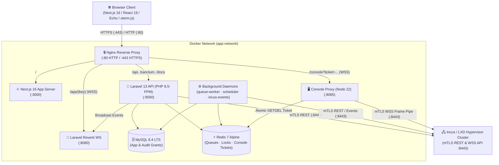

# 🔥 Ognivo

**Modern Open-Source Cloud Control Plane for Incus & LXD Hypervisors**

[](https://www.php.net/)
[](https://laravel.com/)
[](https://nextjs.org/)
[](https://react.dev/)
[](https://docs.docker.com/compose/)
[](LICENSE)

**Ognivo** is a multi-tenant virtualization control plane for orchestrating **KVM virtual machines** and **LXC system containers** across distributed **Incus** and **LXD** clusters. Built as a clean, security-first open-source alternative to SolusVM, Virtualizor, and Proxmox VE, it combines a strongly typed Laravel 13 backend, a reactive Next.js 16 dashboard, real-time Reverb WebSockets, and a dedicated mTLS WebSocket console proxy.

---

## ✨ Key Highlights

- **🔐 Cryptographic Hypervisor Onboarding (mTLS & Trust Pinning)**
  Automatic `secp384r1` X.509 client certificate lifecycle, one-time trust token onboarding, server certificate SHA-256 fingerprint pinning, and zero-downtime certificate rotation.
- **🖥️ Zero-Knowledge Interactive Web Console (`xterm.js`)**
  Live terminal streaming via an isolated Node.js `console-proxy` microservice using single-use 60-second Redis tickets (`GETDEL`). Enforces **strict tenant privacy**: administrators are cryptographically and policy-blocked from accessing customer guest consoles.
- **📸 Asynchronous Point-in-Time Snapshots**
  Stateful and stateless snapshots for VMs and containers with distributed Redis locks, real-time WebSocket progress transitions, per-tier quota limits, and a pluggable `BackupTargetInterface`.
- **🌐 Ranged IPAM & Multi-Mode Networking**
  IPv4/IPv6 subnet pools with **Routed** (Layer 3 point-to-point + Cloud-Init Netplan) and **Manual** modes, floating IP allocation/reassignment, Reverse DNS (PTR) management, and hypervisor preflight checks.
- **📊 Multi-Tenant Quota Groups & Atomic Resource Locking**
  Reusable plans/tiers (Standard, Developer, Enterprise Unlimited `∞`) with instant multi-tenant synchronization and race-free provisioning via database row locks and Redis mutexes.
- **🛡️ Tamper-Evident Audit Subsystem**
  Dual-connection transactional audit trail with MySQL privilege separation (`INSERT`/`SELECT`-only app grants in production), periodic SHA-256 hash-chain + HMAC sealing, and GDPR-friendly PII pseudonymisation.
- **⚡ Real-Time Telemetry & Internationalization**
  Instant UI updates over **Laravel Reverb** WebSockets, hypervisor drift detection, bilingual interface (**English** & **Bulgarian**), and **Dark / Light / System** themes.

---

## 🏗️ System Architecture



---

## 🚀 Quick Start

### Prerequisites

- **Docker Engine** `24.0+` & **Docker Compose v2** (`2.20+`)
- **GNU Make**, **Bash**, and **OpenSSL**
- Free host ports: `80`, `3000`, `8080`, `3306` (Development) or `80`, `443` (Production)

### Option A: Development Environment (with Hot-Reload & Demo Seeders)

```bash
# 1. Generate cryptographically random secrets in .env.development and .env.production
make secrets

# 2. Build (if first run) and start all 10 development containers, run migrations & seed demo data
make up-dev
```

### Option B: Production Environment (Hardened HTTPS on Port 443)

```bash
# 1. Generate cryptographic secrets (edit .env.production first if using a custom domain)
make secrets

# 2. Build self-contained production images and launch the HTTPS stack
make build-prod
make up-prod

# 3. Create your initial Administrator account (database seeders are disabled in production)
docker exec -it ognivo-backend php artisan admin:create admin@yourdomain.com --name="Super Admin"
```

| Environment | URL | Health Check | Credentials & TLS Notes |
| :--- | :--- | :--- | :--- |
| **Development** | `http://localhost` *(or `:3000`)* | `http://localhost/up` | **Admin:** `admin@ognivo.local` / `password`<br/>**Customer:** `customer@ognivo.local` / `password` |
| **Production** | `https://localhost` | `https://localhost/up` | Created via `php artisan admin:create`.<br/>Auto-generates a self-signed TLS cert in `./docker/certs/` (`server.crt` / `server.key`); replace files and run `docker exec ognivo-nginx nginx -s reload` for custom TLS. |

> [!CAUTION]
> **Local Development Only:** Never expose the development environment (`make up-dev`) to the public internet. It runs with debug tooling enabled and seeds well-known demo credentials (`admin@ognivo.local` / `password`). For any internet-facing server, always use `make up-prod`.

> [!TIP]
> - **Auto-Build & Auto-Secrets:** Running `make up-dev` or `make up-prod` on a fresh clone automatically generates missing `.env.*` files, builds missing Docker images, and installs missing `composer` dependencies in development. Use `make build-dev` / `make build-prod` to rebuild images after changing `Dockerfile` or package manifests.
> - **Port Conflict Guard:** Starting `make up-dev` automatically stops the production containers (and vice versa). Run `make ps` to inspect container health or see the [**Quickstart Guide**](docs/getting-started/quickstart.md) for a complete walkthrough.

---

## 📚 Documentation

All documentation is organized by domain inside the [`docs/`](docs/README.md) directory:

### 🏁 Getting Started
| Guide | Description |
| :--- | :--- |
| [**Quickstart Guide**](docs/getting-started/quickstart.md) | Prerequisites, secret generation, and launching your first environment |
| [**Development Environment**](docs/getting-started/development.md) | Container topology, hot reloading, seeded demo accounts, and local ports |

### 🏛️ Architecture & Security
| Guide | Description |
| :--- | :--- |
| [**System Architecture**](docs/architecture/overview.md) | Backend domain model, Next.js App Router structure, API map, WebSockets, and data flows |
| [**Security & Audit Log**](docs/architecture/security-and-audit.md) | Security controls, tamper-evident audit logging, strict DB grants, and HMAC seal key rotation |

### 🧩 Core Features & Subsystems
| Guide | Description |
| :--- | :--- |
| [**Host Onboarding & mTLS**](docs/features/host-onboarding.md) | Panel X.509 certificates, one-time trust tokens, fingerprint pinning, and verification |
| [**Networking & IPAM Modes**](docs/features/networking.md) | Routed vs. Manual network modes, host `sysctl` / Proxy ARP setup, and preflight checks |
| [**Interactive Web Console**](docs/features/console.md) | `xterm.js` terminal, `console-proxy` architecture, Redis tickets, and tenant privacy guardrails |
| [**Virtual Machine Snapshots**](docs/features/snapshots.md) | Snapshot state machine, concurrency locks, quota behavior, REST API, and backup extensions |

### 🛠️ Operations & Reference
| Guide | Description |
| :--- | :--- |
| [**Production Deployment**](docs/operations/production.md) | Building images, safety enforcement, admin creation, and Let's Encrypt / custom TLS setup |
| [**Configuration Reference**](docs/operations/configuration.md) | Complete `.env` variable reference, Reverb origin rules, healthchecks, and `APP_KEY` rotation |
| [**Commands Cheat Sheet**](docs/operations/commands.md) | Makefile targets, Docker Compose commands, Artisan CLI, and MySQL/Redis inspection |
| [**Troubleshooting**](docs/operations/troubleshooting.md) | Common startup, database, port conflict, and reverse-proxy fixes |

### 🧪 Testing & Quality Assurance
| Guide | Description |
| :--- | :--- |
| [**Automated Testing**](docs/testing/automated-testing.md) | Fast SQLite unit tests, MySQL/Redis integration suite, PHPStan Level 10, Psalm, and Node tests |
| [**Manual QA & API Scenarios**](docs/testing/manual-qa.md) | Step-by-step UI verification workflows and ready-to-run `curl` API recipes |

---

## 🧰 Technology Stack

| Layer | Technologies |
| :--- | :--- |
| **Backend API** | PHP `8.5` (FPM Alpine), Laravel `13`, Laravel Sanctum `4`, Spatie Permission & Model States, Dedoc Scramble (OpenAPI v3) |
| **Frontend UI** | Next.js `16` (App Router, Turbopack), React `19`, TypeScript (Strict), Tailwind CSS `v4`, Lucide Icons, `xterm.js` |
| **Real-Time & Proxy** | Laravel Reverb `1.12` (WebSockets), Laravel Echo, Node.js `22` (`console-proxy` WebSocket mTLS bridge) |
| **Data & Messaging** | Oracle MySQL `8.4 LTS`, Redis `7 Alpine` (`predis`), Nginx `1.27` (Reverse Proxy & TLS Termination) |
| **Quality & Analysis** | Pest PHP `5` / PHPUnit `13`, Larastan / PHPStan (Level 10), Vimeo Psalm (Level 1), ESLint `9`, Node Native Test Runner |

---

## 📄 License & Changelog

- Distributed under the [MIT License](LICENSE).
- Release history and version roadmap are tracked in [`CHANGELOG.md`](CHANGELOG.md).
