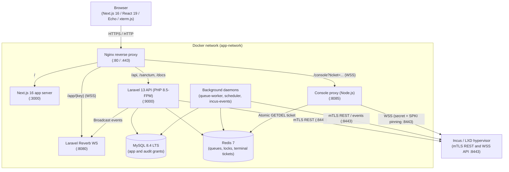

# Ognivo

**Open-source, multi-tenant control plane for KVM virtual machines and LXC system containers on Incus.**

[](https://github.com/schmasterz/ognivo/actions)
[](CHANGELOG.md)
[](LICENSE)
[](https://www.php.net/)
[](https://laravel.com/)
[](https://nextjs.org/)

> [!WARNING]
> **Status: alpha (`1.0.0-alpha.1`).** Ognivo is not production-ready yet. APIs, configuration keys and the database schema may change without migration paths until 1.0. Keep external backups of anything you care about. See [Upgrading](docs/operations/upgrading.md).

<!-- TODO: replace with a real screenshot or short GIF (dashboard, console, IPAM) -->

<p align="center">
  
</p>

Ognivo lets you offer VPS-style hosting on your own **Incus** hypervisors. Customers get a self-service dashboard. Administrators get node, image, network and quota management. Everything is built around tenant isolation and a tamper-evident audit trail.

*Ognivo* (Огниво) is the Bulgarian word for a flint-and-steel fire starter.

## Contents

- [Why Ognivo?](#why-ognivo)
- [Features](#features)
- [Architecture](#architecture)
- [Installation](#installation)
- [Connect your first Incus node](#connect-your-first-incus-node)
- [Supported versions](#supported-versions)
- [Documentation](#documentation)
- [Known limitations](#known-limitations)
- [Roadmap](#roadmap)
- [Upgrading and backups](#upgrading-and-backups)
- [Security](#security)
- [Contributing](#contributing)
- [Technology stack](#technology-stack)
- [License](#license)

## Why Ognivo?

Ognivo is aimed at small hosting providers, labs and self-hosters who run Incus and want a multi-tenant panel with quotas, IP management and a web terminal, without adopting a full virtualization platform.

It is an open-source alternative to hosting panels such as SolusVM and Virtualizor, focused on Incus. It is not a replacement for general-purpose platforms like Proxmox VE and does not aim to be one.

## Features

| Area                  | What you get                                                                                                                                         | Status       |
|:--------------------- |:---------------------------------------------------------------------------------------------------------------------------------------------------- |:------------ |
| Hypervisor onboarding | mTLS with `secp384r1` client certificates, one-time trust tokens, server certificate fingerprint and public-key (SPKI) pinning, certificate rotation | Alpha        |
| Web terminal          | `xterm.js` through an isolated `console-proxy`; exec-based shell with a serial-console fallback; single-use Redis tickets (60 s by default)          | Alpha        |
| Images                | Admin-managed image catalog, per-node image selection                                                                                                | Alpha        |
| Snapshots             | Async stateful and stateless snapshots, distributed locks, per-tier quotas, pluggable `BackupTargetInterface`                                        | Alpha        |
| Networking / IPAM     | IPv4 pools, Routed and Manual modes, IP cooldown quarantine, hypervisor preflight checks                                                             | Alpha        |
| Quotas                | Reusable plans and tiers, race-free provisioning with row locks and Redis mutexes                                                                    | Alpha        |
| Audit log             | Separate audit DB connection, `INSERT`/`SELECT`-only grants in production, SHA-256 hash chain with HMAC seals, PII pseudonymisation                  | Alpha        |
| Real-time UI          | Laravel Reverb WebSockets, drift detection, English and Bulgarian UI, light/dark/system themes                                                       | Alpha        |
| LXD driver            | Best-effort compatibility, see [Supported versions](#supported-versions)                                                                             | Experimental |

Details for each area live in [`docs/`](docs/README.md).

### Tenant privacy

Administrators are blocked by panel policy from opening customer guest terminals, including while impersonating a user. This protects tenants from the panel's own staff, not from someone with root access to the hypervisor itself. See the [threat model](docs/architecture/security-and-audit.md) for what Ognivo does and does not protect against.

## Architecture



Full walkthrough: [System Architecture](docs/architecture/overview.md).

## Installation

Ognivo runs as a Docker Compose stack. There is nothing to install on the host except Docker, Make and OpenSSL. PHP, Node.js and the databases all run in containers.

### Requirements

| Requirement             | Version / note                                                                                                                                                              |
|:----------------------- |:--------------------------------------------------------------------------------------------------------------------------------------------------------------------------- |
| Operating system        | Linux (recommended). macOS works for development. On Windows use WSL2 with Docker Desktop's WSL integration, because the scripts need Bash                                  |
| Docker Engine           | 24.0 or newer                                                                                                                                                               |
| Docker Compose          | v2, 2.20 or newer (`docker compose`, not `docker-compose`)                                                                                                                  |
| GNU Make, Bash, OpenSSL | Any recent version (used by `make secrets`)                                                                                                                                 |
| Git                     | To clone the repository                                                                                                                                                     |
| Resources               | 2 CPU cores and 4 GB RAM are enough for a development stack. The first build downloads several images and runs `composer install` and `npm install`, so allow a few minutes |
| Free host ports         | Development: `80`, `3000`, `8080`, `3306` (MySQL, localhost only). Production: `80`, `443`                                                                                  |
| An Incus node           | Only needed to manage real instances. The development stack seeds demo data with a fake driver, so you can explore the UI without one                                       |

Check your tools:

```bash
docker --version && docker compose version && make --version && openssl version && git --version
```

### 1. Clone the repository

```bash
git clone https://github.com/schmasterz/ognivo.git
cd ognivo
```

Prefer a release over the moving `main` branch? List the tags and check one out:

```bash
git tag --list
git checkout v1.0.0-alpha.1
```

Downloaded a ZIP instead (for example `ognivo-main.zip`)? Unpack it and `cd` into the folder. The folder name does not matter, because the Compose project name is fixed to `ognivo`.

### 2a. Development install (hot reload, demo data)

```bash
make secrets   # creates .env.development and .env.production with random secrets
make up-dev    # builds images, starts all containers, runs migrations, seeds demo data
```

`make up-dev` creates the env files for you if they do not exist, so `make secrets` is optional on a fresh clone. It does not overwrite existing values.

The first start takes a few minutes. Watch progress and wait until the containers report `healthy`:

```bash
make ps
make logs-dev      # Ctrl+C to stop following
```

Then open:

| What                        | URL                         |
|:--------------------------- |:--------------------------- |
| Web panel                   | `http://localhost`          |
| API documentation (OpenAPI) | `http://localhost/docs/api` |
| Health check                | `http://localhost/up`       |

| Role     | Email                   | Password   |
|:-------- |:----------------------- |:---------- |
| Admin    | `admin@ognivo.local`    | `password` |
| Customer | `customer@ognivo.local` | `password` |

> [!CAUTION]
> **Local development only.** The development stack runs with debug tooling and well-known demo credentials, and some ports are published on all network interfaces. Never run it on a server reachable from the internet. Use the production install below.

### 2b. Production install (hardened, HTTPS on port 443)

Run these on the server that will host the panel.

**1. Generate secrets.**

```bash
make secrets
```

**2. Set your domain** in `.env.production` *before* building. The `NEXT_PUBLIC_*` values are baked into the frontend image at build time.

```ini
APP_URL=https://panel.example.com
REVERB_ALLOWED_ORIGINS=https://panel.example.com
SANCTUM_STATEFUL_DOMAINS=panel.example.com   # add this line if it is not in the file yet
```

**3. Allow private node addresses if needed.** By default production refuses to add Incus nodes on private (RFC 1918) or loopback addresses (an SSRF protection). If your nodes are on a LAN, add:

```ini
HYPERVISOR_ALLOW_PRIVATE_ENDPOINTS=true
```

**4. Build and start.**

```bash
make build-prod
make up-prod
make ps            # wait until every container with a healthcheck is "healthy"
```

If the configuration is unsafe (placeholder passwords, `APP_DEBUG=true`, wildcard origins and so on), the backend refuses to start and says why in `make logs-prod`.

**5. Create the first administrator.** Seeders are disabled in production.

```bash
docker exec -it ognivo-backend php artisan admin:create admin@yourdomain.com --name="Super Admin"
```

Without `--password`, a strong password is generated and printed once.

**6. Open the panel** at your `APP_URL` (for a local test: `https://localhost`). The health check is `/up`.

**7. Install a real TLS certificate.** On first start a self-signed certificate is created in `./docker/certs/`, so browsers will warn. Replace it and reload Nginx:

```bash
cp /path/to/fullchain.pem docker/certs/server.crt
cp /path/to/privkey.pem   docker/certs/server.key
chmod 600 docker/certs/server.key
docker exec ognivo-nginx nginx -s reload
```

> [!IMPORTANT]
> Back up `.env.production`, especially `APP_KEY` and `AUDIT_HMAC_KEY`. Losing `APP_KEY` makes encrypted data (panel certificate key, node tokens, SMTP password) unreadable. See [Backup and restore](docs/operations/backup-restore.md).

Firewall: expose only `80` and `443` to the internet. The panel host must be able to reach each Incus node on port `8443`.

### Day-to-day commands

| Action                                         | Development      | Production        |
|:---------------------------------------------- |:---------------- |:----------------- |
| Start (builds missing images)                  | `make up-dev`    | `make up-prod`    |
| Rebuild after Dockerfile or dependency changes | `make build-dev` | `make build-prod` |
| Status and health                              | `make ps`        | `make ps`         |
| Follow logs                                    | `make logs-dev`  | `make logs-prod`  |
| Stop                                           | `make down-dev`  | `make down-prod`  |
| Reset the dev database                         | `make reset-dev` | not applicable    |

Starting one environment stops the other, so they never fight over ports. After editing `.env.development` or `.env.production`, run `make up-dev` or `make up-prod` so the containers are recreated with the new values. More in the [Commands reference](docs/operations/commands.md).

### Uninstall

```bash
make down-dev            # or make down-prod
# Optional: also delete the data volumes (irreversible)
docker volume ls | grep ognivo
docker volume rm <volume-name>
```

Full walkthrough with explanations: [Installation guide](docs/getting-started/installation.md) and [Quickstart](docs/getting-started/quickstart.md). Problems? See [Troubleshooting](docs/operations/troubleshooting.md).

## Connect your first Incus node

Ognivo is only useful once it manages a hypervisor.

**On the Incus host** (Incus 6.0 LTS or newer, with KVM support; nested virtualization if the host is itself a VM):

```bash
# Make the Incus API reachable by the panel (default is local-only)
incus config set core.https_address <host-ip>:8443

# Create a one-time trust token for the panel
incus config trust add token ognivo-panel
```

**In the Ognivo admin UI:**

1. Open **Compute Nodes**, click **Create Node**, choose **Connect with token**.
2. Enter a name, paste the token and set the CPU, RAM and storage capacity.
3. Click **Connect with token**. Ognivo verifies the server fingerprint from the token before sending any secret, then pins it.
4. Select the images this node should offer, then create an IP pool for it under **Networking & IPAM**.

Notes:

- If the Incus host and the panel run on the same machine, the panel containers must reach Incus on a host address that is routable from the Docker network. `localhost` inside a container is the container itself.
- On a production panel, nodes on private addresses need `HYPERVISOR_ALLOW_PRIVATE_ENDPOINTS=true` (see the production install).
- For Routed networking, the node also needs IP forwarding and Proxy ARP, see [Networking & IPAM](docs/features/networking.md).

Alternative flow with a pre-trusted certificate and full details: [Host Onboarding & mTLS](docs/features/host-onboarding.md).

## Supported versions

- **Incus 6.0+ LTS** is the officially supported platform. Container and VM orchestration, snapshots and terminal streaming are tested against it.
- **LXD** is experimental and best-effort. Core operations share API compatibility, but production deployments should use Incus.

## Documentation

| Section                   | Guides                                                                                                                                                                                                                                                                                                                                                                   |
|:------------------------- |:------------------------------------------------------------------------------------------------------------------------------------------------------------------------------------------------------------------------------------------------------------------------------------------------------------------------------------------------------------------------ |
| Getting started           | [Installation](docs/getting-started/installation.md), [Quickstart](docs/getting-started/quickstart.md), [Development environment](docs/getting-started/development.md)                                                                                                                                                                                                   |
| Architecture and security | [System architecture](docs/architecture/overview.md), [Security and audit log](docs/architecture/security-and-audit.md)                                                                                                                                                                                                                                                  |
| Features                  | [Host onboarding & mTLS](docs/features/host-onboarding.md), [Images](docs/features/images.md), [Networking & IPAM](docs/features/networking.md), [Web terminal](docs/features/terminal.md), [Snapshots](docs/features/snapshots.md)                                                                                                                                      |
| Operations                | [Production deployment](docs/operations/production.md), [Upgrading](docs/operations/upgrading.md), [Backup and restore](docs/operations/backup-restore.md), [Scheduled tasks](docs/operations/scheduler.md), [Configuration reference](docs/operations/configuration.md), [Commands](docs/operations/commands.md), [Troubleshooting](docs/operations/troubleshooting.md) |
| Reference                 | [API](docs/reference/api.md) (interactive OpenAPI at `/docs/api` on a running panel)                                                                                                                                                                                                                                                                                     |
| Testing                   | [Automated testing](docs/testing/automated-testing.md), [Manual QA & API scenarios](docs/testing/manual-qa.md)                                                                                                                                                                                                                                                           |

<!-- NOTE: Images, Upgrading, Backup and restore, Scheduled tasks, Web terminal and API pages do not exist yet. Create them or remove these links before publishing. -->

## Known limitations

- **IPv4 only.** IPAM supports IPv4 pools and allocation. IPv6 and dual-stack guests are planned for 1.1.
- **Standalone nodes.** Each Incus endpoint is one compute node. Cross-cluster migration, cluster-wide storage pools, SSO/OIDC and object storage buckets are out of scope for 1.0.
- **No plans or products yet.** Tenants pick CPU, RAM and disk within their quota. Overcommit is a global setting in `.env`.
- **Bearer tokens in `localStorage`.** API tokens are stored in the browser and mitigated by a strict CSP and XSS hygiene. Migration to `httpOnly` SameSite cookies is planned (tracked in [issues](https://github.com/schmasterz/ognivo/issues)).

## Roadmap

Planned work is tracked [`CHANGELOG.md`](CHANGELOG.md). Current priorities: finishing 1.0 (instance access provisioning, VM metrics), `httpOnly` cookie authentication, IPv6 IPAM, storage pool selection and more backup targets.

## Upgrading and backups

- **Alpha releases:** versions before the first beta may need a fresh install. Each release's notes in [`CHANGELOG.md`](CHANGELOG.md) say whether an in-place upgrade is supported. See [Upgrading](docs/operations/upgrading.md).

- **Typical upgrade of an existing install** (when supported):
  
  ```bash
  git fetch --tags && git checkout <new-tag>
  make build-prod
  make up-prod                       # runs migrations on start
  docker exec ognivo-backend php artisan audit:grants --force   # only if the release notes ask for it
  ```

- **MySQL grants:** the users `ognivo_user`, `audit_writer` and `audit_maintenance` are created at first install and not modified on upgrade. When a release changes privileges, re-apply them with `php artisan audit:grants --force`.

- **What to back up:** the MySQL volume, `.env.production`, `docker/certs/`. Details in [Backup and restore](docs/operations/backup-restore.md).

## Security

Please report vulnerabilities privately, not through public issues. See [`SECURITY.md`](SECURITY.md) for the contact address and disclosure process. The security model and threat model are described in [Security and audit log](docs/architecture/security-and-audit.md).

## Contributing

Contributions are welcome, including translations (the UI is available in English and Bulgarian). Read [`CONTRIBUTING.md`](CONTRIBUTING.md) and [`CODE_OF_CONDUCT.md`](CODE_OF_CONDUCT.md) first. Tests and static analysis (Pest, Pint, PHPStan level 10 and Psalm level 1 with baselines, ESLint, Node test runner) are described in [Automated testing](docs/testing/automated-testing.md).

## Technology stack

| Layer     | Technologies                                                                                                |
|:--------- |:----------------------------------------------------------------------------------------------------------- |
| Backend   | PHP 8.5 (FPM Alpine), Laravel 13, Sanctum 4, Spatie Permission and Model States, Dedoc Scramble (OpenAPI 3) |
| Frontend  | Next.js 16 (App Router, Turbopack), React 19, strict TypeScript, Tailwind CSS 4, Lucide, `xterm.js`         |
| Real-time | Laravel Reverb 1.12, Laravel Echo, Node.js 26 `console-proxy`                                               |
| Data      | MySQL 8.4 LTS, Redis 7 (`predis`), Nginx                                                                    |
| Quality   | Pest 5 / PHPUnit 13, Pint, Larastan (level 10), Psalm (level 1), ESLint 9, Node test runner                 |

## License

Distributed under the [MIT License](LICENSE). Release history: [`CHANGELOG.md`](CHANGELOG.md).