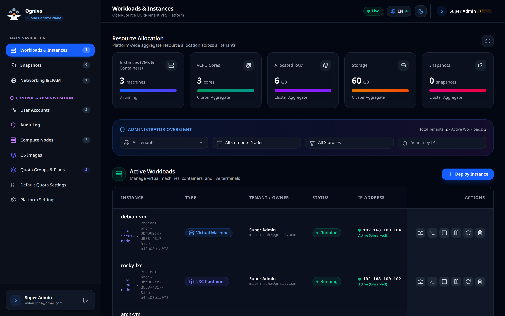

# Ognivo Documentation Hub

Welcome to the **Ognivo** technical documentation. All guides are organized into six categories. For a short overview of the project, see the [main README](../README.md).

---

## 1. Getting Started (`docs/getting-started/`)
- **[Installation Guide](getting-started/installation.md)** - Requirements, cloning the repository, development and production installs, TLS certificates, firewall, connecting the first Incus node, verification, updating, removal, and installation troubleshooting.
- **[Quickstart Guide](getting-started/quickstart.md)** - Prerequisites, generating `.env` secrets, and starting Development or Production in minutes.
- **[Development Environment](getting-started/development.md)** - Docker service layout, hot reloading, seeded demo data (accounts, quota tiers, nodes, images, IP pool, instances), and local ports.
- **[Compute Node Setup](getting-started/compute-node-setup.md)** - Prepare a dedicated Linux server as an Incus hypervisor host (KVM checks, genisoimage, sysctl, NAT/firewall rules, remote API).

## 2. Architecture & Security (`docs/architecture/`)
- **[System Architecture Overview](architecture/overview.md)** - High-level topology, Backend Eloquent models & services, Next.js 16 App Router architecture, API endpoint map, Reverb WebSockets, and lifecycle sequence diagrams.
- **[Security & Tamper-Evident Audit Log](architecture/security-and-audit.md)** - Defense-in-depth controls, mTLS key protection, strict MySQL privilege separation, SHA-256 hash-chain + HMAC sealing, PII pseudonymisation, and HMAC key rotation.

## 3. Features & Subsystems (`docs/features/`)
- **[Host Onboarding & mTLS Certificates](features/host-onboarding.md)** - Preparing the Incus/LXD host, panel X.509 client certificate lifecycle, single-use trust tokens, pre-trusted certificate setup, certificate and public-key pinning, and connection verification states.
- **[OS Images](features/images.md)** - The image catalog (allowlist), image fields and Incus aliases, per-node image selection and auto-attach, impact preview before detaching, and what happens to existing instances when images change.
- **[Network Modes & Host IPAM](features/networking.md)** - Routed (`routed`), Bridged (`bridged`), Macvlan (`macvlan`), and Manual (`manual`) IPv4 subnet pools, pool address/free-IP inspection, required hypervisor `sysctl` / Proxy ARP and bridge/NIC requirements, preflight pool verification, and IP version support.
- **[Interactive Web Terminal](features/console.md)** - `xterm.js` terminals through the `console-proxy`, the `exec` and serial `console` drivers, single-use Redis tickets, session limits and idle timeout, the read-only boot log, and strict tenant privacy isolation.
- **[Virtual Machine Snapshots](features/snapshots.md)** - Point-in-time VM/container snapshots, state machine, concurrency locks, quota enforcement, REST API, and `BackupTargetInterface` extension points.
- **[Instance Metrics](features/metrics.md)** - Per-instance historical telemetry (`1h`–`30d`), `METRICS_ENABLED` flag, `incus-agent` requirements, 3-tier retention (`12h / 8d / 35d`), storage growth formula, and `mysqldump` backup exclusion.

## 4. Operations & Reference (`docs/operations/`)
- **[Production Deployment](operations/production.md)** - Building self-contained images, startup safety enforcement, creating the initial administrator, and installing real TLS certificates.
- **[Configuration Reference](operations/configuration.md)** - Environment variable dictionary with code defaults and production example values, terminal settings, Reverb WebSocket split flow, healthchecks, production safety checks, and `APP_KEY` rotation procedure.
- **[Commands Reference](operations/commands.md)** - Makefile targets, native Docker Compose commands, Laravel Artisan CLI (setup, hypervisor, audit), scheduled tasks and background daemons, and MySQL/Redis container inspection.
- **[Troubleshooting](operations/troubleshooting.md)** - Solutions for common configuration, port binding, database credential, and Nginx reverse-proxy issues.

## 5. Testing & Quality Assurance (`docs/testing/`)
- **[Automated Testing & Static Analysis](testing/automated-testing.md)** - Running SQLite unit tests, MySQL 8.4 + Redis 7 integration tests, PHPStan Level 10, Psalm ErrorLevel 1, and frontend checks.
- **[Manual QA & API Verification](testing/manual-qa.md)** - End-to-end browser verification scenarios and ready-to-use `curl` API commands.
- **[Manual Incus Network Tests](testing/manual-incus-network-tests.md)** - Hands-on runbook for testing routed, bridged, macvlan, and manual IP pools against a real Incus host.

## 6. Extension Points & Developer Guides (`docs/extensions/`)
- **[Extension Architecture & Manifest](extensions/index.md)** - Architecture overview, `ognivo-extension.json` manifest specification, Composer PSR-4 discovery via `ExtensionRegistry`, and `/api/v1/extensions` API.
- **[Domain Events Catalog](extensions/events-catalog.md)** - Transaction-safe event dispatching (`ShouldDispatchAfterCommit`), payload schemas, and event catalog for all 17 domain events.
- **[Service Contracts](extensions/service-contracts.md)** - Core extension interfaces (`DnsProviderInterface`, `NotificationChannelInterface`, `BillingProviderInterface`, `BackupTargetInterface`) and container binding.
- **[Frontend Slots & Theming](extensions/frontend-slots.md)** - UI slot registry (`slotRegistry.ts`), navigation registry, and theme token customizations.
- **[Webhooks & Service Tokens](extensions/webhooks-and-tokens.md)** - HMAC-SHA256 webhook delivery, retry policies, and `srv_` service tokens with scoped abilities and system audit logging.
- **[Idempotency Engine](extensions/idempotency.md)** - `Idempotency-Key` header, request fingerprinting, atomic locks, and replay responses.
- **[Stability Policy](extensions/stability-policy.md)** - SemVer contract freeze from 1.0.0, deprecation cycle, and breaking change guarantees.

---

## API Reference

The interactive OpenAPI documentation is served by a running panel at `/docs/api` (for example `http://localhost/docs/api` in development).

## Project Files

- [README](../README.md) - Project overview, features, and installation summary.
- [CHANGELOG](../CHANGELOG.md) - Release history and roadmap.
- [CONTRIBUTING](../CONTRIBUTING.md) - How to contribute.
- [SECURITY](../SECURITY.md) - How to report a vulnerability.
- [CODE_OF_CONDUCT](../CODE_OF_CONDUCT.md) - Community standards.