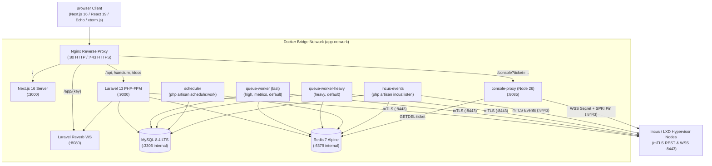
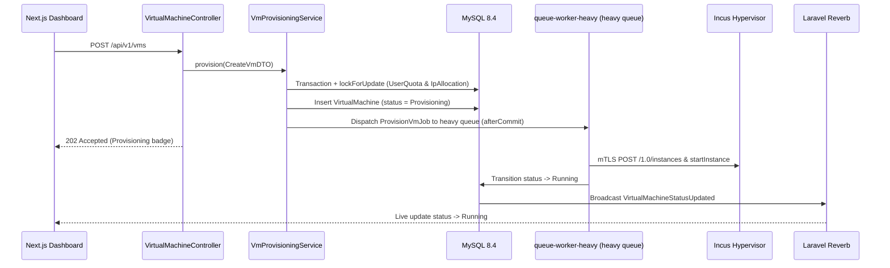

# System Architecture Overview

**Ognivo** is a multi-tenant cloud control plane for orchestrating **LXC containers** and **KVM virtual machines** on **Incus** and **LXD** hypervisors.

---

## 1. High-Level Architecture

The platform is built as a decoupled, containerized stack:
- **Backend API:** **Laravel 13** (PHP 8.5-FPM) using immutable `readonly` DTOs, constructor-injected domain services, Eloquent Policies, Spatie Model States (`VmState`), and a pluggable hypervisor driver layer (`HypervisorDriverInterface`).
- **Frontend Web App:** **Next.js 16** (App Router, React 19, TypeScript, Tailwind CSS v4) organized with Route Groups (`(auth)` and `(dashboard)`), scoped domain contexts, bilingual i18n (`en` / `bg`), Dark/Light/OS themes, and real-time Echo WebSocket synchronization.
- **Console Proxy:** A standalone **Node.js 26** microservice (`console-proxy`) that redeems single-use 60-second Redis tickets (`GETDEL`) and pipes `xterm.js` WebSocket frames over mTLS to Incus/LXD.
- **Data & Messaging:** **MySQL 8.4 LTS** (transactional state + privilege-separated audit tables), **Redis 7 Alpine** (queues, distributed locks, cache, console tickets), and **Laravel Reverb** (real-time WebSocket broadcasting).



## 2. Backend Domain Architecture

### 2.1 Core Eloquent Models (`backend/app/Models/`)

1. **`User`** — Tenant and administrator accounts (`HasApiTokens`, `HasRoles`). Generates isolated per-tenant Incus projects (`proj-{uuid}`) via `ensureProjectName()`.
2. **`UserQuota` & `QuotaGroup`** — Tiered resource plans and per-user limits for VMs, vCPU cores, RAM, disk, public IPs, and snapshots (`-1` denotes unlimited `∞`). Editing a `QuotaGroup` automatically synchronizes all assigned users.
3. **`Host`** — Hypervisor cluster nodes (`incus`, `lxd`, or `fake` driver), capacity boundaries, pinned TLS certificate fingerprint, and `needs_retrust` status.
4. **`VirtualMachine`** — Customer workloads (KVM VMs and LXC containers) managed via `VmState` (`Provisioning`, `Running`, `Stopped`, `Suspended`, `Deleting`, `Deleted`, `Failed`). Dispatches `VirtualMachineStatusUpdated` on state/IP mutations.
5. **`VmSnapshot`** — Crash-consistent point-in-time disk captures (`creating`, `ready`, `restoring`, `deleting`, `failed`) with `source` discriminator (`manual`, `scheduled`).
6. **`IpPool` & `IpAllocation`** — Ranged IPv4 subnet pools (`routed`, `bridged`, `macvlan`, or `manual` mode) and individual IP allocations (`allocated`, `cooling`).
7. **`Image`** — Curated OS image catalog synchronized with hypervisor image servers.
8. **`PanelCertificate`** — Self-signed `secp384r1` mTLS client certificate and encrypted private key (`active`, `retiring`).
9. **`AuditLog` & `AuditSeal`** — Tamper-evident audit events and periodic SHA-256 + HMAC cryptographic seals.
10. **`DriftReport`** — Records of state discrepancies detected between the control-plane database and live Incus/LXD hypervisors.
11. **`SystemSetting`** — Global key-value configuration (public registration toggle, allowed instance types, SMTP settings).

### 2.2 Service & Driver Layer (`backend/app/Services/`)

- **`VmProvisioningService`** — Performs race-free quota and IP allocation inside database transactions with `lockForUpdate()` and Redis distributed locks, then dispatches `ProvisionVmJob` after commit.
- **`HypervisorManager` & Drivers (`IncusDriver`, `LxdDriver`, `FakeHypervisorDriver`)** — Implements `HypervisorDriverInterface` over mTLS REST (`/1.0/instances`, `/1.0/projects`, `/1.0/certificates`, `/1.0/events`).
- **`InstanceSpecBuilder` & Guest OS Adapters (`GuestOsResolver`, `GuestOsAdapterInterface`)** — Responsible for generating compliant Incus instance payloads (devices, root disk, `eth0` NIC, `agent:config` drive) and tailoring cloud-init networking and hypervisor configuration across distinct OS families.
- **`IncusTrustService` & `PanelCertificateService`** — Handles single-use trust token onboarding, TLS peer certificate fingerprint verification, and mTLS key rotation.
- **`ConsoleTicketService`** — Issues 60-second single-use Redis console tickets without exposing hypervisor credentials to the client.
- **`VmSnapshotService` & `LocalSnapshotTarget`** — Coordinates snapshot operations through `BackupTargetInterface` with per-VM mutex locks.
- **`AuditLogger` & `AuditSealService`** — Writes transactional and out-of-band fail-closed audit events and signs periodic HMAC hash chains.

---

## 3. Frontend Architecture (`frontend/src/`)

Routes are organized using **Next.js App Router Route Groups** (see [`frontend/AGENTS.md`](../../frontend/AGENTS.md)):

```text
src/app/
├── layout.tsx                        # Root providers: Theme -> I18n -> Toast -> Auth -> GlobalFilters
├── (auth)/                           # Unauthenticated routes (/reset-password, /verify-email)
└── (dashboard)/                      # Authenticated routes sharing DashboardProvider & DashboardShell
    ├── layout.tsx                    # Persistent Sidebar, Navbar, QuotaSection, FilterToolbar, Modals
    ├── page.tsx                      # -> / (Instances overview)
    ├── instances/page.tsx            # -> /instances (VmsTab)
    ├── snapshots/page.tsx            # -> /snapshots (Global SnapshotsTab)
    ├── networking/page.tsx           # -> /networking (NetworkingTab & IPAM)
    ├── users/page.tsx                # -> /users (UsersTab, admin-only)
    ├── nodes/page.tsx                # -> /nodes (NodesTab, admin-only)
    ├── audit/page.tsx                # -> /audit (AuditLogTab, admin-only)
    └── activity/page.tsx             # -> /activity (Tenant activity log)
```

- **State & Caching:** Domain hooks (`useVms`, `useNetworking`, `useUsers`) use `useCachedFetch` with session-isolated cache keys (`user?.id`), `AbortController` request cancellation, and automatic cache clearing on login/logout/impersonation.
- **Real-Time Synchronization:** `useDashboardRealtime` subscribes to `private-users.{userId}` and `private-admin.workloads` over Laravel Echo, updating VM and snapshot badges in place without page reloads.

---

## 4. Core Lifecycle Flows

### 4.1 Instance Provisioning Flow



> **Note:** `ProvisionVmJob` is dispatched to the `heavy` queue and processed by `queue-worker-heavy`, isolating long-running provisioning tasks from fast control-plane jobs on `high`, `metrics`, and `default`.

### 4.2 WebSocket Broadcasting Channels (`backend/routes/channels.php`)

- **Endpoint:** `/api/v1/broadcasting/auth` (authenticated via Sanctum Bearer token).
- **`private-users.{id}`:** Receives `VirtualMachineStatusUpdated` and `SnapshotStatusUpdated` events for workloads owned by user `{id}`.
- **`private-admin.workloads`:** Receives cluster-wide workload and snapshot updates for users with the `admin` role.
