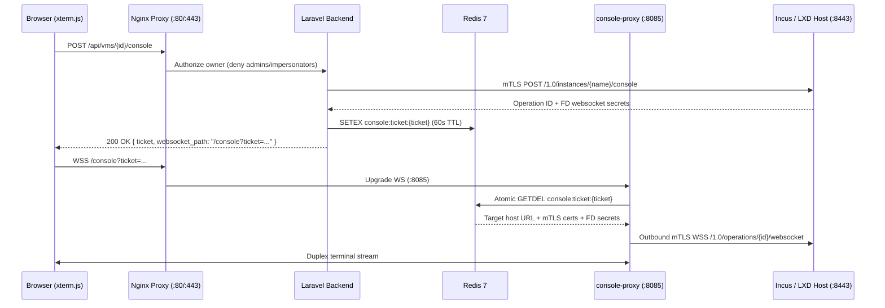

# Interactive Web Console

Ognivo provides a real-time interactive web console for containers and virtual machines, streaming live terminal sessions into the browser via `xterm.js` and the dedicated `console-proxy` microservice.

---

## 1. Architecture Overview



### Two-Tier Zero-Knowledge Ticket Lifecycle
1. The authenticated workload owner requests `POST /api/vms/{id}/console`.
2. The Laravel backend verifies ownership via `VirtualMachinePolicy::viewConsole` and invokes `createConsoleSession` on the hypervisor driver.
3. Incus starts a console websocket operation and returns internal file descriptor (`fd`) secrets.
4. `ConsoleTicketService` stores the hypervisor endpoint, mTLS credentials, and operation secrets in Redis with an exact **60-second TTL** (`console:ticket:{ticket}`).
5. The API returns **only** the opaque ticket and relative WebSocket path:
   ```json
   {
     "virtual_machine_id": 42,
     "ticket": "c8a4e3...",
     "websocket_path": "/console?ticket=c8a4e3...",
     "expires_at": "2026-11-06T13:20:00Z",
     "type": "console"
   }
   ```
   > **Security Invariant:** Hypervisor host IP addresses, mTLS client keys, and Incus operation secrets are **never** exposed to the browser.
6. The browser connects to `wss://<host>/console?ticket=c8a4e3...`.
7. `console-proxy` executes an atomic `GETDEL` in Redis. If valid, it opens an outbound mTLS WebSocket to the hypervisor and bridges the streams; if expired or already used, it closes the socket immediately.

---

## 2. Instance Console Modes

| Instance Type | Current Implementation | Device / Protocol | Planned Extension |
| :--- | :--- | :--- | :--- |
| **LXC Containers** | `xterm.js` | Native PTY (`/dev/console`) | Preserved (`xterm.js`) |
| **KVM Virtual Machines** | `xterm.js` | QEMU Serial Console (`ttyS0` / `virtio-console`) | Graphical VGA (`noVNC` RFB) + Serial Toggle |

---

## 3. Privacy & Security Model (Strict Administrative Denial)

Unlike traditional control panels that allow operators unrestricted access to customer consoles, Ognivo enforces **strict tenant privacy isolation**:

- **Owner-Only Access:** Only the direct tenant owner of the workload can issue console tickets.
- **Explicit Admin Denial:** Administrators are denied guest console access in `VirtualMachinePolicy::viewConsole`:
  > *"Console access is restricted to the workload owner only. Administrators are denied guest access."*
- **Impersonation Guard:** Active administrator impersonation sessions (`AuditContext::getImpersonatorId() !== null`) are blocked from opening console sessions and recorded in the audit log as `vm.action.denied` (`console.ticket`).

---

## 4. REST API Reference

### Issue Console Ticket
```http
POST /api/vms/{id}/console
```

**Optional Parameters:**
- `type`: `console` (default) or `vga` (VMs only).

**Status Codes:**
- `200 OK` — Returns the single-use `ticket`, `websocket_path`, and `expires_at`.
- `403 Forbidden` — Administrator account, non-owner tenant, or active admin impersonation session.
- `409 Conflict` — Instance is not currently in `running` state.
- `422 Unprocessable Content` — `type=vga` requested on a container instance.
