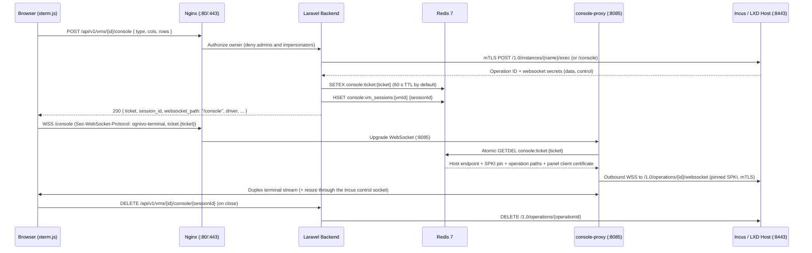

# Interactive Web Terminal

Ognivo gives the owner of a container or virtual machine an interactive terminal in the browser. The terminal is rendered by `xterm.js` and streamed through the dedicated `console-proxy` service. The proxy talks to Incus over mutually authenticated, pinned TLS, so the browser never sees the hypervisor address, a client key or an Incus operation secret.

The terminal is opened through one of two **drivers**. Each driver maps to a different Incus endpoint:

| Driver | Incus endpoint | Transport | What the user gets | Used for |
| :--- | :--- | :--- | :--- | :--- |
| `exec` | `POST /1.0/instances/{name}/exec` | virtio vsock (`incus-agent`) | A new login shell (`bash -l`, falling back to `sh -l`) running as `root` in `/root`, with `TERM=xterm-256color` | **Default.** All containers, and virtual machines that run the Incus guest agent |
| `console` | `POST /1.0/instances/{name}/console` | QEMU `chardev:console` (`ttyS0`) / instance console | The instance's serial/system console (`/dev/console`, `ttyS0`) | Fallback for virtual machines without a running guest agent, live VM boot streaming, and an explicit choice through the API |

Alongside the interactive terminal there is a separate, read-only **Boot Log** tab (see [Boot log](#7-boot-log)). For containers it fetches the retained liblxc console ring buffer via the API; for running virtual machines it attaches or mirrors the live `ttyS0` serial console stream.

---

## 1. Architecture Overview



### Ticket lifecycle

1. The authenticated owner calls `POST /api/v1/vms/{id}/console`.
2. `ConsoleTicketService` checks, in order: the request is not an admin impersonation session, the `viewConsole` policy allows the user, and the instance is `running`.
3. It chooses a driver (see [Driver selection](#2-driver-selection)) and asks Incus to start an exec or console operation. Incus returns an operation ID and per-socket secrets.
4. The service stores a **single-use ticket** in Redis under `console:ticket:{ticket}` (64 random characters) with a TTL of `TERMINAL_TICKET_TTL_SECONDS` (default `60`, minimum `10`). It also records the session in `console:vm_sessions:{vmId}` and `console:session_index` so concurrency limits and closing work.
5. The API returns only the ticket and session metadata. Hypervisor addresses, pins, client keys and operation secrets are **never** part of the response.
6. The browser opens `wss://<host>/console`, sending the ticket in the `Sec-WebSocket-Protocol` header.
7. `console-proxy` redeems the ticket with an atomic `GETDEL`. If it is missing, expired or already used, the upgrade fails. Otherwise the proxy opens the outbound WSS connection to Incus, verifies the server certificate's SPKI hash against the pin stored with the host, and bridges the two sockets.

> [!IMPORTANT]
> The Redis ticket payload contains the panel's mTLS client certificate **and private key** (for at most the ticket TTL) so the proxy can authenticate to Incus. Redis must therefore stay on the internal network and be password-protected. Both are the default in the supplied Compose files.

---

## 2. Driver Selection

The browser UI always requests `type: "console"` without a `driver`, which means **automatic** selection:

| Instance | Requested `driver` | Result |
| :--- | :--- | :--- |
| Container | `auto` / omitted | `exec` |
| Virtual machine | `auto` / omitted | `exec` first. If the guest agent is unavailable (error text mentions `agent`, `vsock`, `not running`, `connection refused`, `timed out` or `disconnected`), falls back to `console` and returns `fallback_reason: "agent_unavailable"` |
| Any | `exec` | `exec` only, no fallback |
| Any | `console` | `console` (serial) only |
| Virtual machine | any, with `type: "vga"` | `console` driver with the VGA stream (see the note below) |

Details:

- **Exec on virtual machines** uses short timeouts (3 s to connect, 5 s overall) so that a missing guest agent fails fast and the fallback can kick in.
- A host **certificate pin mismatch** (`FingerprintMismatchException`) is never treated as "agent unavailable". It aborts the request with no fallback.
- The `exec` driver rejects `type: "vga"`.
- Containers do not support `vga`. The API returns `422`.

> [!NOTE]
> **VGA is not usable from the UI today.** The API accepts `type: "vga"` for virtual machines and opens the Incus VGA console operation, but Ognivo ships no graphical (noVNC/RFB) client, and the web panel never requests it. Treat `vga` as experimental until a client is added.

### Channel independence (`exec` vs. `console`)

The two drivers operate over completely independent transport channels inside Incus and QEMU:

- **`ExecDriver` (`POST /1.0/instances/{name}/exec`)** runs over Incus `/exec` via **virtio vsock** directly to `incus-agent` inside the guest.
- **`ConsoleDriver` (`POST /1.0/instances/{name}/console`)** runs over Incus `/console` via QEMU **`chardev:console` (`ttyS0`)**.

Because these channels do not share a socket or multiplexer, a running virtual machine can simultaneously maintain an interactive `exec` shell in the **Terminal** tab and a read-only serial stream in the **Boot Log** tab.

### Non-disruptive transition when the guest agent starts

If a virtual machine is still booting when the user opens the console, the initial `exec` probe fails fast and the Terminal tab falls back to `console` (`fallback_reason: "agent_unavailable"`). While the Terminal tab is in serial fallback mode:

1. The backend `IncusEventSyncService` listens for Incus 6.23+ `instance-agent-started` lifecycle events and broadcasts `VirtualMachineAgentStarted` on the owner's private Laravel Echo channel (`users.{id}`).
2. The console modal listens for `VirtualMachineAgentStarted` over Laravel Echo (and users can also trigger a manual **Reconnect** on older hypervisors or if WebSocket broadcasting is disabled).
3. Once the guest agent comes online, a non-disruptive banner appears above the terminal: **`"⚡ Guest agent is now online. [Switch to Shell]"`** (and live boot capture in the Boot Log tab freezes automatically).
4. Clicking **Switch to Shell** closes the serial session and explicitly opens a new `driver: "exec"` session (`bash -l`). Ognivo **never** performs silent driver switching mid-session, so any in-progress serial login or diagnostic output is preserved until the user chooses to switch.

### Guest agent and serial console requirements

- `exec` on a virtual machine needs the Incus agent running inside the guest (images with the `/agent` variant, or the agent installed manually).
- The `console` driver shows whatever the guest writes to its serial console. The guest must have a login `getty` on `ttyS0` and, in most cases, a password set, and the guest kernel should be configured with `console=ttyS0` to emit boot messages. A guest with no login prompt on the serial line shows nothing useful once booted. Use the [Boot log](#7-boot-log) tab during startup to inspect what the guest printed at boot.

---

## 3. WebSocket Protocol (`console-proxy`)

**Endpoint:** `wss://<panel-host>/console` (Nginx forwards `/console` to `console-proxy:8085`; read and send timeouts are 3600 s).

### Authentication

The **only** supported ticket transport is the WebSocket subprotocol `ticket.<ticket>` passed in `Sec-WebSocket-Protocol`:

```text
Sec-WebSocket-Protocol: ognivo-terminal, ticket.<ticket>
```

This keeps tickets out of URLs, query strings, and HTTP access logs. The proxy answers the subprotocol handshake with `ognivo-terminal`.

`console-proxy` also enforces two session and origin controls on every connection:

- **`Origin` allowlist (`CONSOLE_ALLOWED_ORIGINS`):** Every WebSocket upgrade request must carry an `Origin` header matching an exact origin in `CONSOLE_ALLOWED_ORIGINS` (comma-separated, no wildcard `*`). In production, `CONSOLE_ALLOWED_ORIGINS` is mandatory and the proxy fails closed if empty or containing `*`.
- **Session expiry enforcement (`session_expires_at`):** Each encrypted ticket payload carries the user's `session_expires_at` timestamp. Upgrades with a missing or already-expired `session_expires_at` are rejected with `403`, and active terminal sockets are closed with WebSocket code `1008` (`Session expired`) as soon as the browser session expires.

### Handshake failures

| HTTP status | Meaning |
| :--- | :--- |
| `404` | Path is not `/console` |
| `401` | No `ticket.<ticket>` subprotocol supplied |
| `400` | Ticket is not 16 to 128 characters of `A-Z a-z 0-9 _ -` |
| `403` | `Origin` missing or not in `CONSOLE_ALLOWED_ORIGINS`; or ticket unknown, expired, already used, undecryptable, or past `session_expires_at` |
| `500` | Unexpected error while redeeming the ticket |

### Frames

| Direction | Frame | Meaning |
| :--- | :--- | :--- |
| Browser to proxy | Binary | Keystrokes, forwarded to Incus unchanged |
| Browser to proxy | Text JSON `{"type":"resize","cols":120,"rows":40}` | Window resize (`width` / `height` are accepted aliases). Forwarded as an Incus `window-resize` control message. Not available on connections without a control socket |
| Proxy to browser | Binary or text | Terminal output |

Messages larger than the session's `max_message_bytes` (default 64 KiB) close the socket with code `1009`.

### Close codes

| Code | Meaning |
| :--- | :--- |
| `1008` | Browser session expired (`session_expires_at` reached) or policy violation (for example, fake driver disabled in production) |
| `4000` | Idle timeout exceeded (the proxy sends a notice line first) |
| `1009` | Message too big |
| `1011` | Upstream connection to the hypervisor failed |
| `1000` / other | Normal close, or Incus ended the session (for example, the user typed `exit`) |

When a session ends because of an idle timeout, an oversized message or an explicit close, the proxy sends `SIGHUP` and `SIGTERM` on the Incus control socket (exec sessions) and cancels the Incus operation, so no orphaned shell stays behind.

---

## 4. Sessions, Limits and Idle Timeout

Every ticket belongs to a **session** with a UUID `session_id`.

| Limit | Default | Environment variable | Behavior when exceeded |
| :--- | :--- | :--- | :--- |
| Concurrent `exec` sessions per instance | `5` | `TERMINAL_MAX_EXEC_SESSIONS` | `429` |
| Concurrent `console` sessions per instance | `1` | `TERMINAL_MAX_CONSOLE_SESSIONS` | `409` |
| Ticket lifetime | `60 s` | `TERMINAL_TICKET_TTL_SECONDS` | Ticket expires, request a new one |
| Idle timeout | `900 s` | `TERMINAL_IDLE_TIMEOUT_SECONDS` | Socket closed with `4000` |
| Maximum WebSocket message | `65536` bytes | `TERMINAL_MAX_MESSAGE_BYTES` | Socket closed with `1009` |
| Ticket and boot-log requests | `6` per minute | (route throttle) | `429` |

Values are clamped to sane minimums (ticket TTL at least 10 s, idle timeout at least 30 s, session limits at least 1, message size at least 1024 bytes). Terminal dimensions are clamped to 20 to 500 columns and 5 to 200 rows.

The idle timeout and message limit are copied into the ticket, so they apply to that session even if the proxy's own defaults differ.

> [!NOTE]
> **Activity tracking and unredeemed tickets.** When the browser opens the WebSocket connection, `console-proxy` marks the session as redeemed (`redeemed_at`) in Redis and refreshes `last_activity_at` (along with the Redis key TTL) approximately every 30 seconds while traffic flows. Active sessions therefore retain their concurrency slot as long as the terminal is in use, and unredeemed tickets automatically release their concurrency slot once `TERMINAL_TICKET_TTL_SECONDS` expires.

### Closing a session & tab persistence

- **Closing sessions:** The web panel calls `DELETE /api/v1/vms/{id}/console/{sessionId}` when the modal is closed or the terminal reconnects. This removes the session from the concurrency count and cancels the Incus operation. If the browser disappears without calling it, the proxy cleans up the Redis records itself when the socket closes.
- **Single serial slot coordination:** Because Incus permits only one concurrent `console` (`ttyS0`) session per instance (`TERMINAL_MAX_CONSOLE_SESSIONS=1`), the Terminal and Boot Log tabs coordinate usage on virtual machines:
  - When the Terminal tab runs on `exec` (virtio vsock), the serial slot is free and the Boot Log tab lazily attaches its own read-only `console` session when opened.
  - When the Terminal tab runs in `console` fallback mode, it holds the sole serial slot and the Boot Log tab mirrors incoming serial output instead of opening a second WebSocket. If a separate Boot Log serial session was open when the Terminal tab switches to `console`, it is released first (`reason: "terminal_took_serial"`).
- **Persistent DOM mounting:** Both the Terminal and Boot Log tab containers remain mounted in the DOM and are toggled with CSS (`hidden`). Switching between tabs never closes active WebSockets, clears terminal history, or forces `xterm.js` re-initialization.

---

## 5. Privacy & Security Model (Strict Administrative Denial)

Ognivo enforces **tenant privacy isolation** on guest terminals:

- **Owner-only access.** Only the user who owns the workload can issue terminal tickets, read the boot log or close sessions.
- **Explicit admin denial.** `VirtualMachinePolicy::viewConsole` denies every user with the `admin` role. The message is: *"Console access is restricted to the workload owner only. Administrators are denied guest access."*
- **Impersonation guard.** While an administrator impersonates a user, ticket issuance is refused with `403` and recorded as `vm.action.denied` (`action: console.ticket`, `reason: forbidden_while_impersonating`).
- **Single-use, short-lived tickets** redeemed with an atomic `GETDEL`.
- **No secrets in the browser.** Responses go through `ConsoleSessionDTO`, which only contains session metadata.
- **Pinned upstream TLS.** The proxy checks the Incus server's SubjectPublicKeyInfo (SPKI) hash (`sha256//...`) against `hosts.server_public_key_pin` and refuses the connection on mismatch.

This policy protects tenants from the panel's staff. It does not protect them from someone with root access to the hypervisor itself.

### Audit events (tenant-visible)

| Action | Written when |
| :--- | :--- |
| `console.ticket.issued` | A ticket is issued (context: `console_type`, `driver`, `session_id`) |
| `terminal.session.opened` | A session is recorded (adds `fallback_reason`) |
| `terminal.session.closed` | A session is closed (adds `duration_seconds` and `reason`, for example `client_disconnect`, `client_closed`, `reconnect`, `modal_closed`, `idle_timeout`, `ticket_expired`) |
| `vm.action.denied` | Impersonation or policy denial (`action: console.ticket`, `reason: forbidden_while_impersonating` or `policy_denial`) |
| `vm.action.requested` | Boot log viewed (`action: console_log.viewed`, `bytes_returned`) |

---

## 6. REST API Reference

All endpoints require an authenticated browser session (cookie + `X-XSRF-TOKEN` on state-changing requests) and live under `/api/v1`. Interactive documentation is available at `/docs/api`.

### Issue a terminal session

```http
POST /api/v1/vms/{id}/console
```

**Body parameters (all optional):**

| Field | Values | Default | Notes |
| :--- | :--- | :--- | :--- |
| `type` | `console`, `vga` | `console` | `vga` is for virtual machines only and is not supported by the web panel |
| `driver` | `auto`, `exec`, `console` | `auto` | See [Driver selection](#2-driver-selection) |
| `cols` (alias `width`) | integer | `80` | Clamped to 20 to 500 |
| `rows` (alias `height`) | integer | `24` | Clamped to 5 to 200 |

**Response `200 OK`:**

```json
{
  "virtual_machine_id": 42,
  "session_id": "0b7f6a52-3f4e-4c0e-9d52-0c1f3a8a9c11",
  "ticket": "c8a4e3...",
  "websocket_path": "/console",
  "expires_at": "2026-11-16T13:20:00+00:00",
  "type": "console",
  "driver": "exec",
  "fallback_reason": null,
  "idle_timeout": 900
}
```

`websocket_path` is a path without a query string. Open `wss://<host><websocket_path>` and pass the `ticket` in the `Sec-WebSocket-Protocol` header as described in [WebSocket Protocol](#3-websocket-protocol-console-proxy). `driver` is the driver actually used and `fallback_reason` is `agent_unavailable` when a virtual machine fell back to the serial console.

**Status codes:**

| Code | Reason |
| :--- | :--- |
| `200` | Ticket issued |
| `403` | Administrator account, non-owner, or active admin impersonation session |
| `409` | Instance is not `running`; or a serial console session is already active; or the guest agent is unavailable and the serial console is already in use |
| `422` | Invalid `type` or `driver`, or `vga` requested for a container |
| `429` | Too many concurrent `exec` sessions on the instance, or the `6 per minute` route throttle |
| `5xx` | The hypervisor refused to create the session (for example, no shell found in the guest, host unreachable) |

### Close a terminal session

```http
DELETE /api/v1/vms/{id}/console/{sessionId}
```

Optional body field `reason` (default `client_disconnect`) is stored in the audit log. Returns `{ "closed": true }` if the session existed and was closed, otherwise `{ "closed": false }`. Requires the same owner-only permission as issuing a ticket.

### Boot log

```http
GET /api/v1/vms/{id}/console-log
```

See [Boot log](#7-boot-log).

### Removed and invalid endpoints

| Endpoint | Behavior |
| :--- | :--- |
| `POST /api/v1/vms/{id}/console-ticket` | **Removed.** Returns `404`; use `POST /api/v1/vms/{id}/console` instead |
| `GET /api/v1/vms/{id}/console` | Always `404`. Terminals are only issued with `POST` |

---

## 7. Boot Log

In the web panel, the **Boot Log** tab sits alongside the **Terminal** tab inside the console modal. Because Incus handles console output differently for containers and QEMU virtual machines, Ognivo uses a distinct source strategy for each instance type:

| Instance type | Primary Boot Log source | Retention & behavior | Buffer cap |
| :--- | :--- | :--- | :--- |
| **LXC Container** | `GET /api/v1/vms/{id}/console-log` → Incus `GET /1.0/instances/{name}/console?buffer=true` | Reads liblxc's in-memory ring buffer; retains historical boot logs even hours after boot (and while stopped, if retained by Incus) | **Last 50 KB** (tail) |
| **Virtual Machine (running, `exec` Terminal)** | `POST /api/v1/vms/{id}/console` (`driver: "console"`) → Incus `POST /1.0/instances/{name}/console` | Opens an independent, read-only live WebSocket stream to QEMU `chardev:console` (`ttyS0`) alongside the `exec` shell | **First 50 KB** (`51,200` chars HEAD cap) |
| **Virtual Machine (running, `console` fallback Terminal)** | Mirrored from the Terminal tab's active `console` WebSocket | Mirrors incoming `ttyS0` chunks into the Boot Log viewer without opening a second serial socket | **First 50 KB** (`51,200` chars HEAD cap) |
| **Virtual Machine (stopped)** | `GET /api/v1/vms/{id}/console-log` | Returns an explanatory notice (QEMU VMs do not expose a retained console ring buffer) | N/A |

### Why VMs stream `ttyS0` instead of polling `/console?buffer=true`

- **No hypervisor buffer for QEMU VMs:** On Incus, `GET /1.0/instances/{name}/console?buffer=true` only applies to containers and returns `404` (`"Instance is not container type"` / `"no such file or directory"`) for virtual machines. VM boot output exists strictly on the emulated serial port (`ttyS0`).
- **Channel independence:** When a running VM already has its guest agent online and the Terminal tab uses `ExecDriver` (virtio vsock), the serial channel (`ConsoleDriver` over QEMU `chardev:console`) remains completely free, allowing the Boot Log tab to attach a live read-only serial stream simultaneously.

### Incus serial replay limits and post-boot notice

When a client attaches to a VM's serial console WebSocket, Incus streams output **live** from QEMU's `chardev` and does **not** dump or replay historical ringbuffer output across the newly opened socket.

If you open the console modal **after** a VM has finished booting and `ttyS0` is idle, no bytes arrive on the serial socket. After a 2-second grace period with no output, the Boot Log tab displays an informational overlay notice explaining that serial output is streamed live during boot and is not retained by the hypervisor once booted (and reminding you to verify `console=ttyS0` in the guest kernel command line if output never appears even during startup).

### Boot log freeze strategy (HEAD cap & prompt/agent transition)

When capturing or mirroring a VM's `ttyS0` stream during boot, the Boot Log buffer automatically **freezes** as soon as any of the following occurs:

1. **Login prompt detected:** A `login:` prompt appears at the tail of the serial output (evaluated after stripping ANSI escape sequences).
2. **Guest agent becomes ready:** Incus emits `instance-agent-started` and the frontend receives `VirtualMachineAgentStarted`.
3. **50 KB HEAD limit reached:** Captured VM boot output reaches `51,200` characters (`50 KB` from the start of the stream).

Using a hard **HEAD cap** rather than a rolling tail guarantees that interactive keystrokes, login attempts, passwords, or post-boot shell commands entered in serial fallback mode never push out earlier UEFI/OVMF, GRUB, or kernel initialization messages. Clicking **Refresh** in the Boot Log tab resets the freeze state and re-attaches (or clears and resumes mirroring) for a new capture.

### Read-only `xterm.js` rendering and persistent DOM mounting

- **Full terminal emulation (`ReadOnlyXtermViewer`):** Rather than stripping ANSI codes into plain text, the Boot Log tab renders both container logs and VM serial streams inside a read-only `xterm.js` instance (`disableStdin: true`, `cursorBlink: false`). This keeps UEFI/GRUB menus, cursor positioning, and colorized boot status indicators (`[  OK  ]`, `[FAILED]`) intact while still allowing one-click **Copy Boot Log** from the rendered terminal buffer.
- **Persistent DOM mounting:** The Boot Log tab container stays mounted in the DOM alongside the Terminal tab and toggles visibility via CSS (`hidden`), preventing WebSocket disconnections or terminal state loss when switching tabs.

### REST API endpoint (`GET /api/v1/vms/{id}/console-log`)

```http
GET /api/v1/vms/{id}/console-log
```

Returns the container's retained console buffer (`GET /1.0/instances/{name}/console?buffer=true` on Incus), or an informational notice for virtual machines:

```json
{ "virtual_machine_id": 42, "name": "ct-example", "output": "..." }
```

- **Read-only**, independent of active `exec`/`console` sessions and of the guest agent. Works for stopped containers too, as long as Incus still holds a buffer.
- Container responses are capped to the **last 50 KB**.
- Enforces the same owner-only policy and `6 per minute` throttle as terminal tickets. Each view is audited (`vm.action.requested`, `action: console_log.viewed`).
- If Incus cannot return a container buffer, the endpoint still answers `200` with an explanatory message in `output` (for example, `Unable to fetch console log from hypervisor. Instance status: ...` or `Console buffer is empty.`). For virtual machines, `output` states that boot output is streamed in real time via `ttyS0` during startup.

---

## 8. Configuration

### Backend (`config/hypervisor.php`, `terminal`)

| Variable | Default | Description |
| :--- | :--- | :--- |
| `TERMINAL_TICKET_TTL_SECONDS` | `60` | Ticket lifetime (minimum 10) |
| `TERMINAL_IDLE_TIMEOUT_SECONDS` | `900` | Idle timeout copied into each ticket (minimum 30) |
| `TERMINAL_MAX_EXEC_SESSIONS` | `5` | Concurrent `exec` sessions per instance |
| `TERMINAL_MAX_CONSOLE_SESSIONS` | `1` | Concurrent `console` sessions per instance |
| `TERMINAL_MAX_MESSAGE_BYTES` | `65536` | Largest accepted WebSocket message (minimum 1024) |

### `console-proxy` service

| Variable | Default | Description |
| :--- | :--- | :--- |
| `PORT` | `8085` | Listening port |
| `CONSOLE_ALLOWED_ORIGINS` | `http://localhost` (dev); required in prod | Comma-separated exact `Origin` allowlist for WebSocket upgrades (no `*`). Fails closed in production if empty or containing `*` |
| `REDIS_HOST` / `REDIS_PORT` / `REDIS_PASSWORD` | `127.0.0.1` / `6379` / none | Redis used to redeem tickets and clean up sessions. Must be the same Redis as the backend |
| `REDIS_PREFIX` | none | Laravel Redis key prefix. If you changed the backend's Redis prefix, set it here too, otherwise tickets are not found. Common default prefixes are tried automatically |
| `CLIENT_CERT_PATH` / `CLIENT_KEY_PATH` | none | Fallback client certificate and key files, used only when the ticket carries none |
| `MAX_MESSAGE_BYTES` | `65536` | Default maximum message size (the ticket value wins) |
| `IDLE_TIMEOUT_SECONDS` | `900` | Default idle timeout (the ticket value wins) |

Health check: `GET /health` on the proxy returns `{"status":"ok","service":"console-proxy"}`.

---

## 9. Development with the Fake Driver

When the host driver is `fake` (the seeded demo nodes), the proxy does not contact Incus. It answers with a simulated shell: `exec` sessions print `root@fake-instance:~#` and echo input, `console` sessions print a `login:` prompt. This is for UI development only. Real exec and serial behavior needs a real Incus node.

---

## 10. Troubleshooting

| Symptom | Likely cause | What to check |
| :--- | :--- | :--- |
| `409` "only available while the instance is running" | Instance is stopped, starting or in error | Start it, or use the Boot Log tab (containers retain logs; VMs stream live during startup) |
| `409` "serial console session is already active" | Only one `console` (`ttyS0`) session per instance is allowed (`TERMINAL_MAX_CONSOLE_SESSIONS=1`) | Close the other terminal/tab holding the serial slot, or wait for the idle timeout |
| `429` "Maximum number of concurrent terminal sessions" | 5 `exec` sessions already open | Close old sessions, or raise `TERMINAL_MAX_EXEC_SESSIONS` |
| VM terminal opens a serial login prompt instead of a shell | Guest agent not running yet or not installed (`fallback_reason: "agent_unavailable"`) | If the VM is still booting, wait for the **`"⚡ Guest agent is now online. [Switch to Shell]"`** banner (or click **Reconnect**) once `incus-agent` starts; otherwise use an agent-enabled image or install the agent in the guest |
| VM Boot Log shows `"Waiting for serial console output..."` | Console modal opened after the VM already booted (Incus does not replay past `ttyS0` output on attach), or guest kernel lacks `console=ttyS0` | Reboot the VM with the Boot Log tab open to capture live startup output, and verify `console=ttyS0` in the guest kernel cmdline |
| VM Boot Log stops updating after `login:` or 50 KB | Expected freeze behavior (`Boot log capture completed.`) | Preserves early UEFI/kernel boot output from being overwritten by typing; click **Refresh** in the Boot Log tab to start a new capture |
| Serial console is blank | No `getty` on `ttyS0`, or the guest has no password | Check the Boot Log during startup; configure a serial `getty` on `ttyS0` |
| Socket fails with HTTP `403` | Ticket expired (over 60 s between the POST and the WebSocket), already used, or the proxy uses a different Redis or prefix | Request a new ticket; check `REDIS_*` and `REDIS_PREFIX` on `console-proxy` |
| Socket closes with `1011` | The proxy cannot reach Incus, or the SPKI pin does not match | Check the node status and the host's stored pin (`hosts:backfill-pins`); see [Host Onboarding](host-onboarding.md) |
| Terminal closes after 15 minutes of silence | Idle timeout (`4000`) | Raise `TERMINAL_IDLE_TIMEOUT_SECONDS` |
| Admin cannot open a tenant's terminal | By design | Ask the tenant, or use the hypervisor directly |