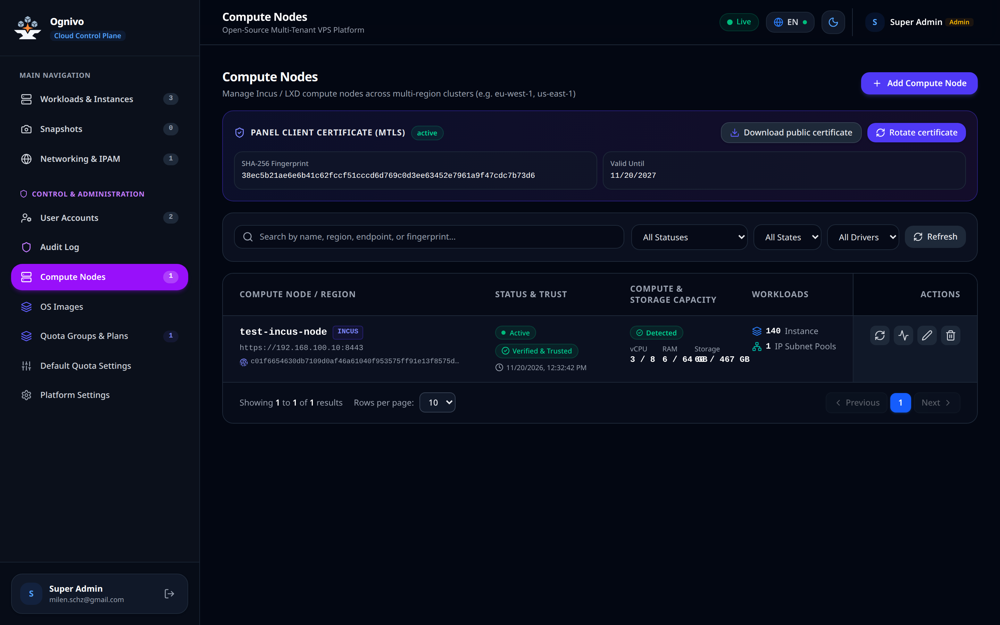

# Host Onboarding & mTLS Certificate Guide

Ognivo manages **Incus** and **LXD** hypervisor nodes using mutual TLS (**mTLS**) with dedicated panel client certificates and strict server TLS fingerprint pinning. The browser never communicates directly with hypervisors; all operations are authenticated and proxied by the backend and `console-proxy`.

---

## 1. Panel Client Certificate Management

The panel automatically generates and manages a self-signed elliptic-curve X.509 client certificate (`secp384r1`, `sha384`, CN `incus-panel`, Extended Key Usage: `clientAuth`). If no active certificate exists in the database yet, one is automatically provisioned when an administrator opens **Compute Nodes** (`GET /api/admin/incus/certificate`), downloads the public certificate (`GET /api/admin/incus/certificate/download`), or runs `php artisan incus:generate-cert`.

- **Private Key Security:** Stored encrypted in the database (`encrypted` Eloquent cast using AES-256-CBC), hidden from model serialization, and supplied in-memory via `CURLOPT_SSLCERT_BLOB` / `CURLOPT_SSLKEY_BLOB` (with a transient `0600` tempfile fallback in `sys_get_temp_dir()` unlinked immediately after use).
- **Zero-Downtime Rotation:** When rotating via `POST /api/admin/incus/certificate/rotate` or `php artisan incus:generate-cert --force`, the previous certificate transitions to `retiring` status and all existing hosts are flagged with `needs_retrust = true`.
- **Revocation Safety Guard:** Retiring certificates cannot be revoked (`POST /api/admin/incus/certificate/revoke-old`) until all hosts have confirmed re-trust (`pending_retrust_hosts_count === 0`). In the **Compute Nodes** (`/nodes`) UI, the **Revoke Old Certificate** button is displayed in the retiring certificate banner and remains disabled until all hosts have confirmed re-trust (`pending_retrust_hosts_count === 0`).
- **Expiry Monitoring:** `WarnExpiringPanelCertificateJob` runs daily and logs warnings when the active certificate is within 30 days of expiration.

---

## 2. Adding an Incus / LXD Compute Node

### Before You Start

- **The hypervisor must listen on the network.** By default Incus only listens locally. On the hypervisor host, run once:
  ```bash
  incus config set core.https_address <node-ip>:8443
  ```
  On LXD, use `lxc config set core.https_address <node-ip>:8443`.
- **The panel must be able to reach it.** The panel's containers need a route to `<node-ip>:8443`. If Incus runs on the same machine as the panel, use an address that containers can reach; `localhost` inside a container is the container itself.
- **Private addresses in production.** A production panel rejects nodes on private (RFC 1918) or loopback addresses unless `HYPERVISOR_ALLOW_PRIVATE_ENDPOINTS=true` is set in `.env.production`. See the [Configuration Reference](../operations/configuration.md#hypervisor-connectivity).

### Path A: Connect with a Single-Use Trust Token (Recommended)

This is the fastest and safest onboarding flow. The trust token encodes connection addresses, the server certificate fingerprint, and a one-time secret.

#### Step 1: Generate Trust Token on the Hypervisor Host
SSH into your hypervisor server and run:

- **On Incus:**
  ```bash
  incus config trust add <node-name-or-panel>
  ```
- **On LXD:**
  ```bash
  lxc config trust add --name <node-name-or-panel>
  ```

*Example Output (Incus):*
```text
Client ognivo-panel certificate add token:
eyJjbGllbnRfbmFtZSI6InBhbmVsIiwiZmluZ2VycHJpbnQiOiI5YjkzNWY5...
```

#### Step 2: Onboard Node in the Web UI
1. Open **Compute Nodes** in the Admin sidebar.
2. Click **Create Node** and select the **Connect with token** tab.
3. Enter the Node Name and paste the generated token into the **Trust Token** field. Hardware CPU, RAM, and storage capacity are auto-discovered from the hypervisor by default; optionally configure a manual capacity cap (`<=` physical hardware) or per-node **Overcommit Multipliers** (`cpu_overcommit`, `ram_overcommit`, `disk_overcommit`).
4. Click **Connect with token**.



#### Backend Cryptographic Flow
1. Decodes and validates the Base64 token structure (`client_name`, `fingerprint`, `addresses`, `secret`, `expires_at`).
2. Connects to the first reachable address, extracts the remote peer certificate during the TLS handshake (`TlsPeerCertificateFetcher`), and computes its SHA-256 fingerprint.
3. Compares the live peer fingerprint with the token's expected fingerprint. On mismatch, onboarding is aborted immediately before transmitting any secrets (MITM protection).
4. Submits the panel's public certificate to `POST /1.0/certificates` with `trust_token: <secret>`.
5. Pins the verified server certificate for all future mTLS connections. Both the SHA-256 certificate fingerprint and the SHA-256 hash of the certificate's public key (SPKI pin) are stored; the SPKI pin is also enforced by the `console-proxy` when it connects to the hypervisor.
6. Discards the one-time token (never stored in the database).

---

### Path B: Add with a Pre-Trusted Certificate

Use this path when manual trust store management or firewall rules require out-of-band certificate registration.

#### Step 1: Download the Panel Public Certificate
In the Admin UI under **Compute Nodes**, click **Download public certificate** (or call `GET /api/admin/incus/certificate/download`). The file is named `incus-panel.crt`.

#### Step 2: Trust the Certificate on the Hypervisor Host
Copy `incus-panel.crt` to your server and register it in the trust store:

- **On Incus:**
  ```bash
  incus config trust add-certificate incus-panel.crt
  ```
- **On LXD:**
  ```bash
  lxc config trust add incus-panel.crt
  ```

#### Step 3: Retrieve the Host Server Fingerprint
Run on the hypervisor host (`lxc info` on LXD):
```bash
incus info
```
Copy the 64-character SHA-256 `certificate_fingerprint` value from the `environment` section.

#### Step 4: Register the Node in the Web UI
1. In **Create Node**, select the **Add with certificate** tab.
2. Enter the Node Name, Endpoint URL (e.g., `https://192.168.1.100:8443`), and the Expected Fingerprint. Capacity is auto-discovered from the hypervisor by default unless an optional manual capacity cap is supplied, and per-node overcommit multipliers default to `1.0x`.
3. Click **Verify connection** to test reachability, fingerprint matching, and mTLS client authentication.
4. Click **Add with certificate**.

---

### After the Node Is Added

- **Choose its OS images.** A new node is offered every image that exists in the catalog at that moment. Narrow the list with **Manage images** in the node's form. See [OS Images](images.md).
- **Add an IP pool** for the node under **Networking & IPAM**: [Networking & IPAM](networking.md).

---

## 3. Connection Verification States

The **Verify connection** action (`POST /api/admin/hosts/verify-connection` or `POST /api/admin/hosts/{host}/verify-connection`) returns one of the following states:

| State | Meaning |
| :--- | :--- |
| `ok` | Connected, peer certificate matches pinned SHA-256 fingerprint, and mTLS client is trusted (`auth: "trusted"`). |
| `unreachable` | Host timed out or connection was refused. |
| `fingerprint_mismatch` | Remote server certificate changed or does not match the pinned fingerprint (potential MITM or host reinstallation). |
| `not_trusted` | Server was reached and fingerprint matched, but the panel certificate is not in the server's trust store (`auth: "untrusted"`). |
| `error` | Unexpected transport or protocol error (returns a sanitized error summary). |

---

## 4. Capacity Discovery, Manual Caps, Overcommit & Cluster Endpoints

By default when onboarding a node, the panel queries `GET /1.0/resources` and `GET /1.0/storage-pools/{pool}/resources` to automatically discover physical compute threads, memory, and storage pool capacity (`capacity_source = discovered`).

- **Manual Capacity Caps:** Administrators may optionally set a manual capacity cap (`total_cpu_cores`, `total_ram_mb`, `total_storage_gb`) that is less than or equal to the node's physical hardware resources to reserve capacity for non-panel workloads. Attempting to set manual capacity above the hypervisor's physical resources is rejected with HTTP 422.
- **Per-Node Overcommit Multipliers:** Each compute node defines its own `cpu_overcommit` (`1.0x–16.0x`), `ram_overcommit` (`1.0x–4.0x`), and `disk_overcommit` (`1.0x–4.0x`) multipliers (default `1.0x`). Overcommit expands the aggregate pool available across multiple instances, while any single instance remains strictly bounded by the node's physical capacity minus host reserves.

> [!NOTE]
> For an Incus or LXD **cluster endpoint**, the resource discovery values describe the specific cluster member that answered the REST API request. Ognivo treats each endpoint as one compute node and does not aggregate resources across a cluster, so onboard individual cluster members as separate nodes if you need to use them.