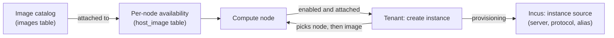

# OS Images

Ognivo only creates instances from images that an administrator has approved. The approved list is the **image catalog** (an allowlist). Administrators also decide **which compute nodes** may offer each image. Tenants see only the images that are enabled and available on the node they pick.

This page explains how the catalog works, how to manage it, how images are attached to nodes, and what happens to existing instances when images change.

---

## 1. Concepts



| Term | Meaning |
| :--- | :--- |
| **Catalog** | All images known to Ognivo. One row per image, unique by `name` |
| **Enabled** | A global switch per image. A disabled image is never offered and cannot be used to provision or reinstall |
| **Attached** | An image is attached to a node when a `host_image` link exists. Only attached images are offered on that node |
| **Auto-attach** | A per-node flag (`auto_attach_images`, on by default). When on, every **new** catalog image is attached to that node automatically |

An image is usable on a node only if it is both **enabled** and **attached** to that node.

---

## 2. Image Fields

| Field | Required | Values and rules | Notes |
| :--- | :--- | :--- | :--- |
| `alias` | Yes | Up to 255 characters | Friendly display name shown to users and administrators, for example `Debian 12`, `AlmaLinux 10`, `Ubuntu 24.04 LTS` |
| `name` | Yes | Up to 255 characters, **unique** | Technical image identifier / alias on the remote image server, for example `debian/12`, `almalinux/10`, `ubuntu/24.04`. See [Name and remote identifier](#21-name-and-remote-identifier) |
| `source` | Yes | Up to 500 characters | Image server URL, for example `https://images.linuxcontainers.org` |
| `protocol` | No | Up to 50 characters, default `simplestreams` | Passed to Incus as the image source protocol |
| `os_type` | No | `linux`, `windows`, `bsd`, `other`. Default `linux` | Containers can only run `linux` images |
| `enabled` | No | Boolean, default `true` | Global on/off switch |

When saving or updating an image, Ognivo verifies that the technical name exists and is reachable on the remote server (`simplestreams`, `incus`, or `lxd`). You can test reachability beforehand with the **Test Remote** button in the web panel or via `POST /api/admin/images/validate`. For offline or isolated lab networks, validation can be bypassed by passing `skip_remote_validation: true`.

### 2.1 Name and remote identifier

`name` is the technical identifier on the remote image server, while `alias` is the friendly display name shown in the panel. Clean remote identifiers like `debian/12`, `almalinux/10`, and `ubuntu/24.04` are the standard recommended format.

The `name` is resolved to the Incus image alias like this:

1. Legacy CLI remote prefixes such as `images:` or `local:` are stripped automatically when resolving the remote alias (for example, `images:ubuntu/24.04` becomes `ubuntu/24.04`). Both spellings work.
2. For Linux and BSD images from `images.linuxcontainers.org` with the `simplestreams` protocol, `/cloud` is appended when the instance needs cloud-init (for example, a user-supplied cloud-init configuration, the network configuration of an instance on a Manual pool, or the network configuration of a virtual machine on a Routed pool), so `ubuntu/24.04` becomes `ubuntu/24.04/cloud` and `freebsd/15.1` becomes `freebsd/15.1/cloud`.

Custom images from other servers are used as they are. Manual-mode instances and virtual machines on Routed pools get their network settings through cloud-init, so make sure such images contain cloud-init. Containers on Routed pools get the address through the Incus NIC and do not need it.

### 2.2 How an image becomes an instance

When an instance is created, Ognivo sends Incus a source built from the catalog entry:

```json
{
  "type": "image",
  "mode": "pull",
  "server": "<source>",
  "protocol": "<protocol>",
  "alias": "<resolved alias>"
}
```

The instance type is `container` or `virtual-machine`. Windows and other non-Linux images are for virtual machines only.

### 2.3 Guest OS Family Abstraction & Cloud-Init Adapters

When provisioning an instance, Ognivo resolves the catalog image to an OS-specific adapter via `GuestOsResolver` and the pluggable `GuestOsAdapterInterface` layer (`backend/app/Services/Hypervisor/GuestOs/`). Each adapter tailors cloud-init network configuration, default login username resolution, and VM hypervisor flags to match the target distribution's network stack and bootloader requirements:

| Adapter | Distributions | Family | Default User | Cloud-Init / Network & VM Notes |
| :--- | :--- | :--- | :--- | :--- |
| `UbuntuOsAdapter` | Ubuntu, Linux Mint, Pop!_OS | `debian` | `ubuntu` | Netplan v2 single default route with `on-link: true` |
| `DebianOsAdapter` | Debian, Kali Linux, Devuan | `debian` | `debian` | Netplan v2 two-route format (`169.254.0.1/32` link route + `0.0.0.0/0 via 169.254.0.1`) required for `systemd-networkd` |
| `RhelOsAdapter` | AlmaLinux, Rocky Linux, CentOS, Fedora, Oracle Linux, RHEL, Amazon Linux, openEuler | `rhel` | Per-distro (`almalinux`, `rocky`, `centos`, `fedora`, `cloud-user`, `ec2-user`, `root`) | Strict sysconfig/NetworkManager compatibility (single default route `to: 0.0.0.0/0 via 169.254.0.1` without `on-link` or extra link routes); `openeuler` automatically disables SecureBoot |
| `AlpineOsAdapter` | Alpine | `alpine` | `alpine` | Cloud-Init Network Config `version: 1` with static subnet `gateway: 169.254.0.1` (`ifupdown-ng` sets up the kernel onlink route natively, whereas Netplan v2 causes `eni.py` renderer crashes); sets `security.secureboot: "false"` on VMs |
| `ArchOsAdapter` | Arch Linux, CachyOS | `arch` | `arch` | Two-route format for `systemd-networkd`; sets `security.secureboot: "false"` on VMs |
| `SuseOsAdapter` | openSUSE Leap/Tumbleweed, SLES | `suse` | `opensuse` | Single route |
| `GentooOsAdapter` | Gentoo Linux | `gentoo` | `gentoo` | Two-route format for `systemd-networkd`; sets `security.secureboot: "false"` on VMs |
| `BsdOsAdapter` | FreeBSD, OpenBSD, NetBSD | `bsd` | `freebsd` | Primary interface is `vtnet0` on VMs (omitting udev renaming, while keeping the Incus NIC device key as `eth0` to override the project's default profile); attaches `cloud-init:config` (`cidata`) alongside `agent:config` on VMs; injects `/etc/rc.conf.d/routing` for FreeBSD `nuageinit` compatibility in routed mode; sets `security.secureboot: "false"` on VMs |

#### KVM VM Devices & SecureBoot

- **SecureBoot handling:** Ognivo automatically sets `security.secureboot: "false"` on KVM virtual machines for images lacking signed Microsoft/UEFI bootloaders (Alpine, Arch, Gentoo, BSD, and openEuler) to prevent Incus hypervisor startup rejection.
- **Agent & cloud-init config drives:** KVM virtual machines automatically receive an `agent:config` virtual CD-ROM device (named `agent`) to deliver cloud-init configuration and `incus-agent` credentials. BSD virtual machines (`BsdOsAdapter`) also attach a `cloud-init:config` (`cidata`) virtual CD-ROM device (named `cloud-init`) alongside `agent:config` so FreeBSD `nuageinit` receives cloud-init configuration, and inject `/etc/rc.conf.d/routing` in routed mode while keeping the Incus NIC device key as `eth0` to override the project's default profile. `migration.stateful: true` is omitted to avoid Incus device conflicts.

---

## 3. Managing the Catalog (Administrators)

### In the web panel

Open the admin menu in the sidebar and choose **OS Images**. From there you can add, edit, enable or disable, and delete catalog images, search and filter them, and choose the compute nodes an image is attached to.

When adding an image, the form defaults to `https://images.linuxcontainers.org` and `simplestreams`, with a name like `ubuntu/24.04`, `debian/12` or `rocky/9`.

### Through the API

All catalog endpoints require an administrator token.

| Method and path | Purpose |
| :--- | :--- |
| `GET /api/admin/images` | List the catalog (see below) |
| `POST /api/admin/images` | Create an image. Optional `host_ids` sets exactly which nodes it is attached to |
| `POST /api/admin/images/validate` | Pre-flight test reachability and architecture compatibility on the remote server |
| `GET /api/admin/images/{id}` | Show one image with its nodes |
| `PUT /api/admin/images/{id}` | Update fields. If `host_ids` is sent, the image's node list is replaced with it |
| `DELETE /api/admin/images/{id}` | Remove the image from the catalog |

**Create example:**

```bash
curl -X POST http://localhost/api/admin/images \
  -H "Authorization: Bearer <ADMIN_TOKEN>" \
  -H "Content-Type: application/json" \
  -d '{
    "alias": "Rocky Linux 9",
    "name": "rocky/9",
    "source": "https://images.linuxcontainers.org",
    "protocol": "simplestreams",
    "os_type": "linux",
    "enabled": true
  }'
```

You can also include `"skip_remote_validation": true` in the payload to bypass remote server verification when creating or updating an image in offline or isolated environments.

**Which nodes get the image.** If you omit `host_ids`, the new image is attached to every node that has **auto-attach** on. If you send `host_ids`, the image ends up attached to **exactly** those nodes, and auto-attach does not add others.

**List parameters** for `GET /api/admin/images`:

| Parameter | Description |
| :--- | :--- |
| `search` | Substring match on name or source |
| `os_type`, `protocol` | Exact match |
| `enabled` | `true` / `false` |
| `host_id` | Adds an `attached` flag to each image for that node |
| `attachment` | `all`, `attached` or `detached`. Only allowed together with `host_id` |
| `per_page` | 1 to 100, default 50 |
| `cursor` | Cursor from the previous page (`next_cursor`) |

Results are ordered by newest first (`id` descending). The response contains `data`, `next_cursor`, `per_page` and `counts` (`filtered` and `overall`, each with `catalog` and `attached`), so a UI can show "N of M" without loading everything.

### Deleting and disabling

- **Delete** removes the image and its node links, subject to deletion protection: Ognivo checks the database for any active virtual machines (`status != 'deleted'`) using the image. If active instances exist, deletion is rejected with an explanatory error, preventing broken workload blueprints. In the administrative UI, an **in use** badge displays the number of active workloads and disables the removal action until those workloads are reallocated or terminated.
- **Disable** keeps the image in the catalog and removes it from every provisioning list.

Instances already created from a disabled image keep running. They store the image name as plain text. However, since the allowlist is checked again when an instance is rebuilt, **reinstalling an instance whose image is disabled (or missing from the catalog) fails** until you re-enable it or choose another image.

### Audit logging

All image catalog lifecycle events are recorded in the immutable audit log with administrator visibility:
- `image.created`: Recorded when a new image is added to the catalog, capturing name, alias, source, protocol, and initial compute node attachments.
- `image.updated`: Recorded when image properties or compute node associations change, capturing attribute diffs.
- `image.deleted`: Recorded when an image is deleted from the catalog, including unlinked compute node counts.

---

## 4. Choosing Which Images a Node Offers

### What a new node gets

When a compute node is added, it is first linked to **all images that exist at that moment**. If you pass an `images` selection in the same request, it is applied right after and can narrow that list. New images added later reach the node automatically only while its **auto-attach** flag is on.

With catalogs of hundreds or thousands of images, you usually want a small, curated list per node.

### In the web panel

In the **Create Node** and **Edit Node** forms, the **Allowed OS Images** section shows a summary such as "12 of 340 selected" and a **Manage images** button. The checkbox **Automatically attach new images** sets the node's auto-attach flag.

**Manage images** opens a drawer where you can:

- Search by name or source.
- Filter by OS type, protocol and enabled state.
- Switch between **All**, **Selected** and **Not selected**.
- Select many images at once, including "all images matching the current filter", then exclude single images.

The panel requires at least one selected image per node. (The API does not enforce this for `delta` selections.)

If you remove images that existing instances on that node use, the panel shows how many instances and which images are affected and asks you to confirm. See [Existing instances](#5-existing-instances-and-image-changes).

### Through the API

`POST /api/admin/hosts` (and the token and certificate onboarding variants) and `PUT /api/admin/hosts/{id}` accept two fields:

| Field | Description |
| :--- | :--- |
| `auto_attach_images` | Boolean, default `true` |
| `images` | An object describing the wanted selection (below) |

The `images` object has a `mode`:

| Mode | Extra fields | Result |
| :--- | :--- | :--- |
| `all` | none | Attach every catalog image. Nothing is detached |
| `selected` | `ids` (1 to 500) | The node ends up with exactly these images. Others are detached |
| `filter` | `filter`, optional `exclude_ids` | The node ends up with exactly the images matching the filter, minus the excluded ones |
| `delta` | `filter_ops` (up to 10), `attach_ids`, `detach_ids` (each up to 500) | Applies changes in this order: filter operations, then attachments, then detachments |

`filter` accepts `search`, `os_type`, `protocol` and `enabled` (a boolean). Each entry of `filter_ops` is `{ "action": "attach" | "detach", "filter": { ... } }`.

**Example: exactly three images**

```json
{ "images": { "mode": "selected", "ids": [1, 4, 9] } }
```

**Example: add all enabled Linux images, then remove one**

```json
{
  "images": {
    "mode": "delta",
    "filter_ops": [
      { "action": "attach", "filter": { "os_type": "linux", "enabled": true } }
    ],
    "detach_ids": [12]
  }
}
```

A `delta` with no operations changes nothing.

**Preview the impact before detaching:**

```http
POST /api/admin/hosts/{host}/images/preview-detach
```

The body is `{ "images": { ... } }` as above (required). The response lists how many images would be attached and detached and which existing instances (deleted ones are not counted) would be affected, without changing anything:

```json
{
  "attached": 0,
  "detached": 2,
  "total_instances": 7,
  "images": [
    { "id": 4, "name": "ubuntu/24.04", "instance_count": 5 },
    { "id": 9, "name": "debian/12", "instance_count": 2 }
  ]
}
```

At most 50 images are listed, most-used first. Instances in the `deleted` state are not counted.

---

## 5. Existing Instances and Image Changes

| Change | Effect on existing instances | Effect on new instances |
| :--- | :--- | :--- |
| Detach an image from a node | None. They keep running. Reinstalling them with their current image still works | The image is no longer offered on that node |
| Disable an image | None while they run. **Reinstall fails** | The image is no longer offered anywhere |
| Delete an image | Blocked while active workloads (`status != 'deleted'`) use it | The image is gone from the catalog once no active workloads remain |
| Re-enable or re-add an image | Reinstall works again | Offered again where attached |

---

## 6. What Tenants See

`GET /api/images` lists enabled images for the signed-in user. Two optional filters are used by the "Create instance" dialog:

| Parameter | Effect |
| :--- | :--- |
| `host_id` | Only images attached to that node |
| `instance_type=container` | Only `linux` images |

The dialog loads the list again when the tenant changes the node or the instance type, and shows a message when nothing is available (for example, "No Linux container images available on this compute node").

When an instance is created or reinstalled, the server validates again:

| Check | Error |
| :--- | :--- |
| Image missing from the catalog or disabled | `os_image`: "The selected image is not in the allowlist or is disabled." |
| Image not attached to the chosen node | `os_image`: "The selected image is not available on the chosen compute node." |
| Container with a non-Linux image | "Containers (LXC) can only run Linux operating system images." |

When no node is chosen, placement only considers nodes that have the image attached, and a node without it is skipped.

---

## 7. Troubleshooting

| Symptom | Likely cause | What to do |
| :--- | :--- | :--- |
| A tenant sees no images | No enabled image is attached to the selected node, or an instance type of `container` with only non-Linux images | Attach images in **Edit Node**, or enable the image |
| New catalog images do not appear on a node | The node's auto-attach flag is off | Attach them in **Manage images**, or turn on **Automatically attach new images** (this affects images created from then on) |
| Saving an image fails with "name has already been taken" | Names are unique | Choose another name, or edit the existing entry |
| Instance creation fails after the form was accepted | The name or source does not exist on the image server, or the server is unreachable from the node | Check the alias on the node with `incus image list <remote>:` or `incus launch <remote>:<alias>` using the same server and protocol |
| Reinstall fails with "not in the approved allowlist or is disabled" | The instance's image was disabled or deleted | Re-enable or re-create the image, or reinstall with another image |
| An instance on a Manual pool, or a virtual machine on a Routed pool, gets no network configuration | The image has no cloud-init | Use an image with cloud-init, for example a `/cloud` variant on `images.linuxcontainers.org`, or configure networking in the guest yourself |

---

## 8. Limitations

- **No automatic discovery.** Ognivo does not read images from the Incus server or the image server. Every image is added to the catalog by hand.
- **Remote validation.** Images can be pre-flight verified with the "Test Remote" button or `php artisan images:verify-catalog`. By default, unverified or invalid remote images are rejected during creation and update unless the administrator chooses to bypass verification.
- **Image-in-use protection on delete.** Image deletion is safeguarded against active workloads: deleting an image is rejected while any active virtual machines (`status != 'deleted'`) use it, while disabling an image remains permitted to hide it from new provisioning.
- **One global catalog.** Images are shared by all tenants. There are no per-tenant or per-plan image lists.