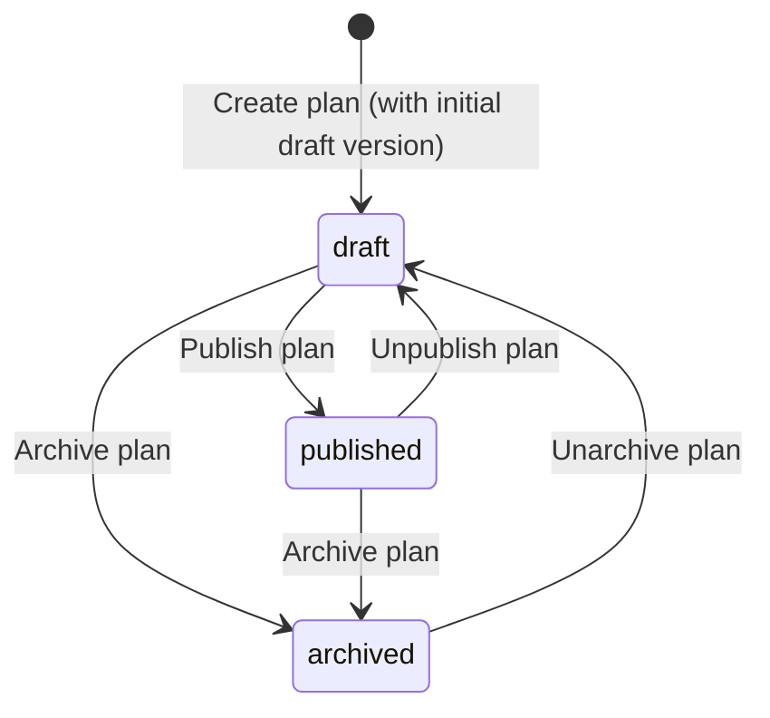
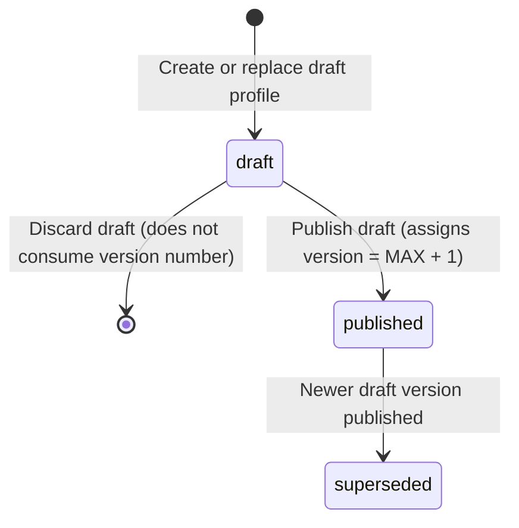
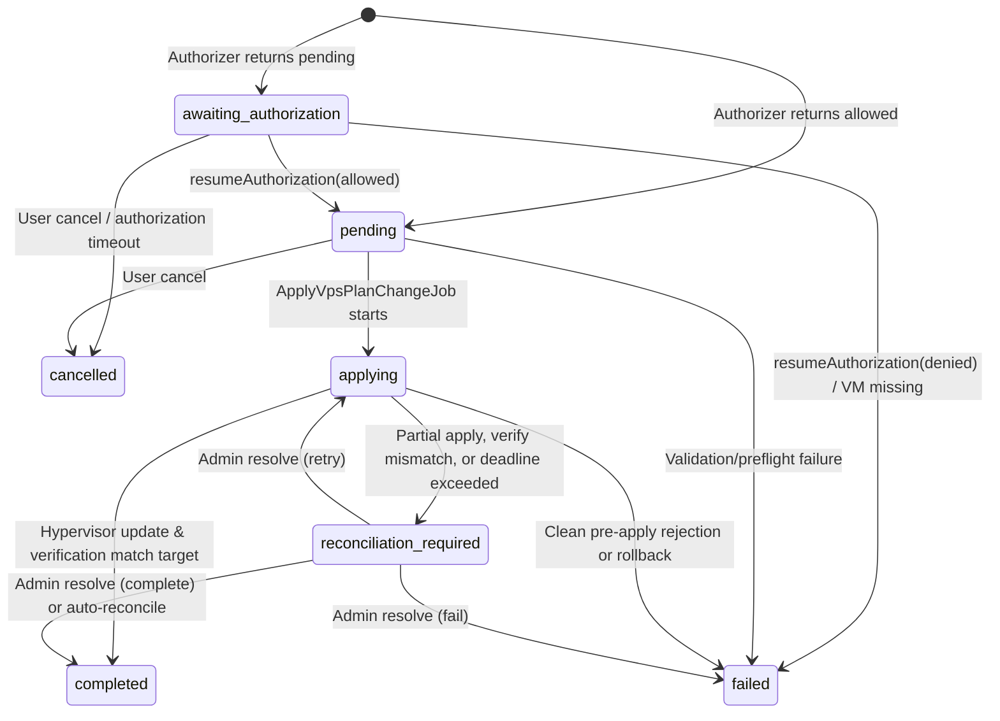

# VPS Plans & Online Plan Changes

Ognivo provides a versioned **VPS Plan Catalog** and an **Online Plan-Change** orchestration subsystem for KVM virtual machines and LXC containers running on Incus and LXD hypervisors.

> [!NOTE]
> For manual troubleshooting of plan changes stuck in `reconciliation_required`, see the [VPS Plan Change Reconciliation Runbook](../operations/vps-plan-reconciliation.md).

---

## 1. Overview

- **Catalog & Immutable Versioning:** Administrators manage reusable VPS plans (`draft`, `published`, `archived`) whose resource profiles are stored in immutable version records (`draft`, `published`, `superseded`) with monotonic `MAX+1` version numbering.
- **Exact Binary Resource Units:** Memory is stored and verified in **MiB** (`1 MiB = 1,048,576 bytes`) and root disk capacity in **GiB** (`1 GiB = 1,073,741,824 bytes`).
- **Online Plan Changes:** Tenants and administrators can preview eligibility, upgrade/downgrade CPU, RAM, and network speed limits, or scale up root disk storage asynchronously without destroying the instance.
- **Custom-to-Plan Assignment:** Existing instances provisioned with custom specs (`vps_plan_version_id = NULL`) can be assigned to any published plan version via an online plan change (`from_version_id = NULL`).
- **Extension Hooks (`@experimental`):** External billing, approval, or UI integrations can participate via `VpsProvisioningAuthorizerInterface`, `VpsPlanChangeAuthorizerInterface`, domain events, and UI slots.

---

## 2. VPS Plan Catalog & Version Lifecycle

### 2.1 Plan Lifecycle (`vps_plans`)

| State | Customer Catalog Visibility | New Provisioning / Plan Changes | Existing VMs |
| :--- | :--- | :--- | :--- |
| `draft` | Hidden | Blocked for customers (`PLAN_NOT_AVAILABLE`) | Unaffected |
| `published` | Visible at `GET /api/v1/vps/plans` | Allowed against `current_version_id` | Unaffected |
| `archived` | Hidden | Blocked for both customers and admins | Unaffected (can still be inspected or migrated off) |

**Slug immutability:** While a plan has never published any version (`versions()->whereNotNull('version')->exists()` is false), its `slug` can be edited via `PATCH /api/v1/admin/vps/plans/{plan}`. Once **any** version of the plan has been published, the `slug` becomes immutable (metadata updates to `name`, `description`, and `sort_order` remain allowed without bumping the version).

### 2.2 Version Immutability (`vps_plan_versions`)

- **At most one draft:** A plan can hold at most one `draft` version (`version = NULL`). Updating the draft via `PUT /api/v1/admin/vps/plans/{plan}/versions/draft` edits or creates that single draft without modifying any already-published version.
- **Monotonic `MAX+1` numbering:** When a draft version is published (`POST /api/v1/admin/vps/plans/{plan}/versions/draft/publish`), `VpsPlanVersionService::publishDraft()` locks the plan, assigns `version = MAX(version) + 1` (starting at `1`), transitions any previously `published` version to `superseded`, sets `vps_plans.current_version_id`, and transitions the draft to `published`.
- **Published & superseded immutability:** Once published, a version's resource profile (`cpu_cores`, `ram_mb`, `disk_gb`, `instance_type`, `net_download_mbps`, `net_upload_mbps`) is never mutated in place. Existing instances pinned to a `superseded` version retain their exact resource snapshot and `vps_plan_version_id` until they undergo a plan change.
- **Publish eligibility (`assertPublishableProfile`):** Publishing a plan or draft version requires at least one active, healthy (`status = ok`) compute host with known physical capacity (`capacity_source != 'unknown'`) whose single-instance physical limit covers `cpu_cores`, `ram_mb`, and `disk_gb`. If `net_download_mbps` or `net_upload_mbps` is non-null, that covering host must also have at least one active non-manual IP pool (`network_mode != 'manual'`).

### 2.3 Resource Bounds (`App\Support\Vps\ResourceBounds`)

| Field | Unit | Minimum | Maximum | Notes |
| :--- | :--- | :--- | :--- | :--- |
| `cpu_cores` | vCPU | `1` | `64` | Integer |
| `ram_mb` | MiB | `512` | `131072` | Integer (`512 MiB` – `128 GiB`) |
| `disk_gb` | GiB | `5` | `2000` | Integer |
| `instance_type` | enum | `virtual-machine` | `container` | Immutable across plan changes for a given instance |
| `net_download_mbps` | Mbps | `1` | `100000` | Nullable; `NULL` means unlimited |
| `net_upload_mbps` | Mbps | `1` | `100000` | Nullable; `NULL` means unlimited |

---

## 3. Provisioning from a Plan vs. Custom Specs

When creating an instance via `POST /api/v1/vms`:

- **Plan-based provisioning (`vps_plan_id`):** Resolves the plan's `currentVersion` (must be in `published` status on a `published` plan), snapshots `cpu_cores`, `ram_mb`, `disk_gb`, `instance_type`, `net_download_mbps`, and `net_upload_mbps` onto the `VirtualMachine`, and records `vps_plan_version_id = currentVersion.id`.
- **Custom provisioning (`vps_plan_id` omitted / `NULL`):** Uses caller-supplied `cpu_cores`, `ram_mb`, `disk_gb`, and `instance_type` with `vps_plan_version_id = NULL` and no network bandwidth limits.

Before entering the provisioning database transaction and locks, `VmProvisioningService` invokes `VpsProvisioningAuthorizerInterface::authorize()` (bounded by `vps.authorizer_timeout_seconds`). See [Service Contracts](../extensions/service-contracts.md) for details.

---

## 4. Online Plan-Change Flow

### 4.1 Discovery, Preview & Submission

1. **List eligible targets (`GET /api/v1/vms/{vm}/plan-change/targets`):** Evaluates all published plans' `currentVersion` records against the VM via `VpsPlanChangeValidator` (throttled via `plan-change-preview`).
2. **Preflight preview (`POST /api/v1/vms/{vm}/plan-change/preview`):** Evaluates a specific target (`vps_plan_id`, or `vps_plan_version_id` for admins targeting any non-draft version of an active published plan) without mutating state. Returns:
   - `can_submit` (`bool`) and `requires_shutdown` (`bool`)
   - `from` and `to` resource snapshots
   - `changes` (`cpu`, `ram`, `disk`, `net_download`, `net_upload`: `increase`, `decrease`, `unchanged`, `limit_added`, `limit_removed`, etc.)
   - `warnings` (for example `DISK_GUEST_RESIZE_MAY_BE_REQUIRED`)
   - `blocking_reasons` (`code`, `message`, optional `kind`)
3. **Submit plan change (`POST /api/v1/vms/{vm}/plan-change`):**
   - Protected by `throttle:vm-actions` and `idempotency` middleware (`Idempotency-Key` scoped per `(user_id, key)`).
   - Runs preflight validation (including hypervisor `assessResourceUpdate()`), invokes `VpsPlanChangeAuthorizerInterface::authorize()` **outside** any database lock or transaction, then acquires `Cache::lock("user_quota_lock:{$userId}", 10)` and `DB::transaction` (`UserQuota` -> `Host` -> `VirtualMachine` row locks) to re-validate without repeating the driver call and insert the `VpsPlanChange` row.
   - Returns **`202 Accepted`** with `VpsPlanChangeResource`. Dispatches `ApplyVpsPlanChangeJob` onto the `high` queue (unless the authorizer returned `Pending`, in which case the operation waits in `awaiting_authorization` until `VpsPlanChangeService::resumeAuthorization()` is called).
4. **Track & cancel:** Poll `GET /api/v1/vms/{vm}/plan-changes/{public_id}` (or listen on Reverb WebSocket updates), list history at `GET /api/v1/vms/{vm}/plan-changes`, or cancel a `pending` / `awaiting_authorization` operation via `POST /api/v1/vms/{vm}/plan-changes/{public_id}/cancel`.

### 4.2 Custom-Sized VM Assignment (`from_version_id = NULL`)

An instance created without a plan (`vps_plan_version_id = NULL`) can be moved onto a published plan version using the exact same preview and submission endpoints:

- `VpsPlanChange.from_version_id` is stored as `NULL`, while `old_resources` snapshots the VM's current `cpu_cores`, `ram_mb`, `disk_gb`, `net_download_mbps`, and `net_upload_mbps`.
- Even if the VM's current resource values happen to match the target plan version numerically, `VpsPlanChangeValidator` treats assigning a plan version (`$vm->vps_plan_version_id !== $targetVersion->id`) as a valid change rather than `NO_CHANGE`.
- On completion, `VirtualMachine.vps_plan_version_id` is updated to `to_version_id`, and `instance.resized` is emitted with `operation_id` and `to_plan_version_id` (omitting `from_plan_version_id` when `null`).

### 4.3 Plan-Change State Machine & Stages

Active states (`pending`, `awaiting_authorization`, `applying`, `reconciliation_required`) hold an active concurrency lock (only one active plan change per VM; concurrent requests fail with `ANOTHER_CHANGE_IN_PROGRESS`) and reserve positive CPU, RAM, and disk deltas via `ResourceReservationService`. Terminal states (`completed`, `failed`, `cancelled`) release all reservations.

Execution stages recorded on `VpsPlanChange.stage`: `authorization` → `validating` → `applying` → `verifying` → `committing`.

---

## 5. Disk, Network Limits & Capacity Rules

### 5.1 Disk Scale-Up Only & Guest Filesystem Expansion Notice

- **Disk shrinking is prohibited:** Target versions with `disk_gb < vm.disk_gb` are rejected with `DISK_SHRINK_NOT_SUPPORTED`.
- **Guest filesystem expansion notice:** Increasing `disk_gb` (`target.disk_gb > vm.disk_gb`) adds the `DISK_GUEST_RESIZE_MAY_BE_REQUIRED` warning in preview responses and in `ChangePlanModal`. Incus/LXD resizes the instance's block device or ZFS/LVM/dir quota, but inside KVM virtual machines (or guests without automatic root-partition growth on boot), the guest partition table and filesystem (`growpart` / `resize2fs` / `xfs_growfs`) may need to be expanded inside the guest OS before the extra space appears in `df -h`.

### 5.2 Network Speed Limits & `manual` Mode Restriction

- Plan versions specify optional `net_download_mbps` (ingress) and `net_upload_mbps` (egress) in Mbps (`1`–`100000`). Setting either or both to `NULL` leaves that direction unlimited.
- **Unit conversion on hypervisor:** Drivers map `net_download_mbps` / `net_upload_mbps` to Incus NIC `limits.ingress` / `limits.egress` (`<mbps>Mbit`), and clear those keys when set to `NULL`.
- **`manual` network mode restriction (`NETWORK_LIMIT_NOT_SUPPORTED_MODE`):** Bandwidth limits require an Ognivo-managed NIC device (`routed`, `bridged`, or `macvlan` IP pool).
  - Provisioning with a plan that defines `net_download_mbps` or `net_upload_mbps` onto a host or pool using `manual` mode fails with HTTP `422` and error code `NETWORK_LIMIT_NOT_SUPPORTED_MODE`.
  - Plan-change preview and submission onto a VM whose primary allocation is in a `manual`-mode IP pool and whose target plan sets network limits are blocked with `NETWORK_LIMIT_NOT_SUPPORTED_MODE`.
  - If the VM has no local NIC device at all when applying network limits, the hypervisor assessment blocks the change with `NETWORK_LIMIT_NO_NIC`.

### 5.3 Network Capacity Non-Reservation

`ResourceReservationService` and `HostCapacityGuard` track and reserve **CPU cores (`cpu_cores`), memory (`ram_mb`), and storage (`disk_gb`)** deltas for active plan changes (`pending`, `awaiting_authorization`, `applying`, `reconciliation_required`). Network bandwidth limits (`net_download_mbps`, `net_upload_mbps`) are per-NIC traffic shaping policies enforced at the hypervisor NIC level and are **not** subtracted from host capacity or user quotas, nor reserved across in-flight plan changes.

---

## 6. REST API Endpoints Summary

### Customer / Tenant Endpoints (`auth:sanctum`, `active`)

| Method | Endpoint | Description |
| :--- | :--- | :--- |
| `GET` | `/api/v1/vps/plans` | List published VPS plans and their `current_version` |
| `GET` | `/api/v1/vps/plans/{slug}` | Show a single published VPS plan by slug |
| `GET` | `/api/v1/vms/{vm}/plan-change/targets` | List published plans evaluated for eligibility against `{vm}` |
| `POST` | `/api/v1/vms/{vm}/plan-change/preview` | Preflight plan-change evaluation (`can_submit`, `changes`, `warnings`, `blocking_reasons`) |
| `POST` | `/api/v1/vms/{vm}/plan-change` | Submit async plan change (`202 Accepted`, supports `Idempotency-Key`) |
| `GET` | `/api/v1/vms/{vm}/plan-changes` | Paginated plan-change history for `{vm}` |
| `GET` | `/api/v1/vms/{vm}/plan-changes/{public_id}` | Show single plan-change status and stage |
| `POST` | `/api/v1/vms/{vm}/plan-changes/{public_id}/cancel` | Cancel a `pending` or `awaiting_authorization` plan change |

> **Note:** Service tokens (`srv_`) are rejected with `403 Forbidden` on `VmPlanChangeController` endpoints (`plans`, `targets`, `preview`, `store`, `cancel`).

### Admin Catalog & Plan-Change Endpoints

Requires `vps.plans.manage` (catalog) or `vps.plan_change.manage` (plan-change inspection & resolution):

| Method | Endpoint | Description |
| :--- | :--- | :--- |
| `GET` | `/api/v1/admin/vps/plans` | List all plans (filter by `status`, `search`) |
| `POST` | `/api/v1/admin/vps/plans` | Create plan in `draft` with initial draft version (`201 Created`) |
| `GET` | `/api/v1/admin/vps/plans/{plan}` | Show plan with `currentVersion` and `draftVersion` |
| `PATCH` | `/api/v1/admin/vps/plans/{plan}` | Update plan metadata (`name`, `description`, `sort_order`, and `slug` before first publish) |
| `POST` | `/api/v1/admin/vps/plans/{plan}/publish` | Publish a `draft` plan |
| `POST` | `/api/v1/admin/vps/plans/{plan}/unpublish` | Return a `published` plan to `draft` |
| `POST` | `/api/v1/admin/vps/plans/{plan}/archive` | Archive a `draft` or `published` plan |
| `POST` | `/api/v1/admin/vps/plans/{plan}/unarchive` | Restore an `archived` plan to `draft` |
| `GET` | `/api/v1/admin/vps/plans/{plan}/versions` | List all versions for a plan |
| `PUT` | `/api/v1/admin/vps/plans/{plan}/versions/draft` | Create or update the plan's draft version |
| `DELETE` | `/api/v1/admin/vps/plans/{plan}/versions/draft` | Discard the plan's draft version |
| `POST` | `/api/v1/admin/vps/plans/{plan}/versions/draft/publish` | Publish draft version (`MAX+1`), superseding any prior published version |
| `GET` | `/api/v1/admin/vps/plans/{plan}/usage` | Active (non-deleted) VM counts per plan version |
| `GET` | `/api/v1/admin/vps/plan-changes` | List all plan changes (`status`, `user_id`, `vm_id`) |
| `GET` | `/api/v1/admin/vps/plan-changes/{public_id}` | Show full plan-change details |
| `POST` | `/api/v1/admin/vps/plan-changes/{public_id}/resolve` | Manually resolve `reconciliation_required` (`complete`, `fail`, `retry`) |
