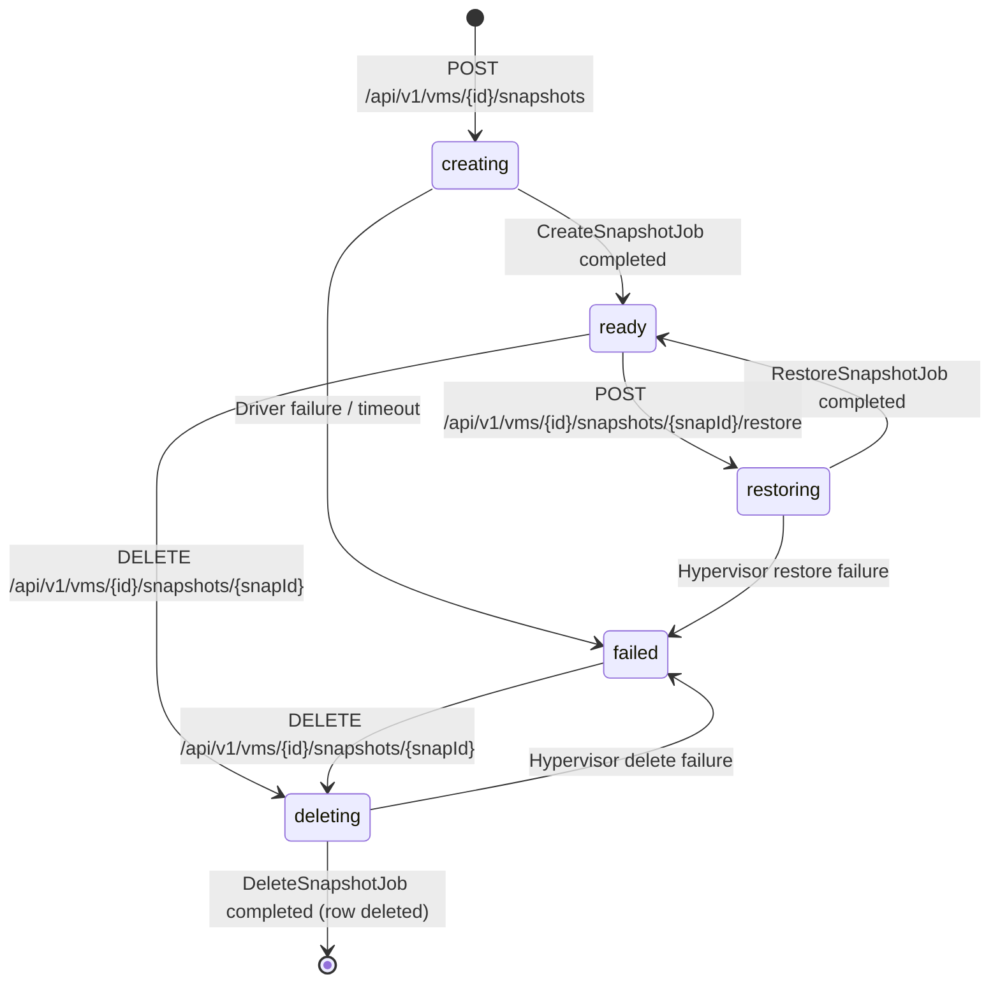

# Virtual Machine Snapshots

Point-in-time disk snapshot subsystem for KVM virtual machines and LXC containers running on Incus and LXD hypervisors.

---

## 1. Overview

The snapshot subsystem allows tenants and administrators to capture, restore, and delete point-in-time snapshots of workloads. All snapshots are crash-consistent point-in-time disk captures of the instance's block storage.

- **Asynchronous Execution:** Creation, restoration, and deletion run as background Redis queue jobs (`CreateSnapshotJob`, `RestoreSnapshotJob`, `DeleteSnapshotJob`).
- **Real-Time WebSocket Events:** Push notifications via `SnapshotStatusUpdated` update the UI immediately as states transition.
- **Strict Quota Enforcement:** Governed by `max_snapshots` per Quota Group or user override, with `-1` representing unlimited (`∞`) headroom.
- **Extensible Storage Contract:** Built on `BackupTargetInterface` (`LocalSnapshotTarget`) to support future offsite backup targets (S3, Ceph, NFS).

---

## 2. State Machine & Concurrency Guards



### Concurrency & State Invariants
1. **Ready Required for Restore:** Only snapshots in `ready` status can be restored (`409 Conflict` otherwise).
2. **Stable VM State Required:** Snapshots can only be created or restored when the VM is in `running`, `stopped`, or `suspended` status.
3. **Single Active Operation per VM:** Concurrent snapshot mutations on the same VM are rejected with `409 Conflict` and serialized in the queue worker via `WithoutOverlapping("vm:{$id}")` and `Cache::lock("vm:{$id}", 30)`.
4. **Quota Calculation:** Active quota usage counts snapshots in `creating`, `ready`, `restoring`, and `deleting` states. Snapshots in `failed` status do not consume quota headroom.
5. **Compute Node Reachability Required:** Snapshots can only be created or restored when the VM's host compute node is reachable. If `host->status === 'unreachable'`, the API rejects the request immediately with HTTP `422 Unprocessable Entity` (`Host Unreachable`).

---

## 3. REST API Endpoints

All endpoints require `auth:sanctum`. Mutating routes enforce `throttle:vm-actions` for customers.

| Method | Endpoint | Response | Description |
| :--- | :--- | :--- | :--- |
| `GET` | `/api/v1/snapshots` | `200 OK` | Global paginated list of snapshots (filtered by tenant ownership, `vm_id`, `status`, `search`, or `user_id` for admins) |
| `GET` | `/api/v1/vms/{vm}/snapshots` | `200 OK` | Lists snapshots for a specific VM alongside quota `meta` (`used`, `max_snapshots`, `remaining`) |
| `POST` | `/api/v1/vms/{vm}/snapshots` | `202 Accepted` | Queues a manual snapshot (`name`) |
| `POST` | `/api/v1/vms/{vm}/snapshots/{snapshot}/restore` | `202 Accepted` | Queues restoration of a `ready` snapshot (by ID or slug name) |
| `DELETE` | `/api/v1/vms/{vm}/snapshots/{snapshot}` | `202 Accepted` | Queues deletion of a snapshot (by ID or slug name) |

### Example: Create Snapshot
```http
POST /api/v1/vms/1/snapshots
Content-Type: application/json

{
  "name": "pre-upgrade-baseline"
}
```
- `name`: Slug-safe identifier (`^[a-z0-9][a-z0-9_-]{0,62}[a-z0-9]$`, max 64 chars).

---

## 4. Extension Points for Remote Backups

1. **`BackupTargetInterface` (`app/Contracts/BackupTargetInterface.php`):** Decouples snapshot storage operations (`create`, `restore`, `delete`, `list`) from hypervisor drivers.
2. **Lifecycle Events (`app/Events/`):** `SnapshotStatusUpdated` broadcasts WebSocket notifications to tenant and administrator channels and serves as the single event hook across snapshot state transitions (`creating`, `ready`, `restoring`, `deleting`, `deleted`, `failed`).
3. **Provenance Discriminator (`source`):** Distinguishes `manual` snapshots from future `scheduled` policy snapshots.
4. **Frontend UI Registry (`frontend/src/lib/registry/vmRegistry.ts`):** Allows dynamically registering tabs (`registerVmTab`) and actions (`registerVmAction`) inside the VM details modal.

---

## 5. Hypervisor Reconciliation (`snapshots:sync`)

To ensure snapshot state stays consistent even if snapshots are created or deleted out-of-band directly on hypervisor hosts, Ognivo provides the `snapshots:sync` Artisan command:

```bash
docker exec -it ognivo-backend php artisan snapshots:sync [host]
```

- **Scheduler:** Triggered hourly (`Schedule::command('snapshots:sync')->hourly()->withoutOverlapping(15)->runInBackground()`).
- **Decoupled Architecture:** Decoupled from the 5-minute `vm:reconcile` loop to eliminate N+1 hypervisor HTTP calls and ensure state reconciliation remains lightweight.
