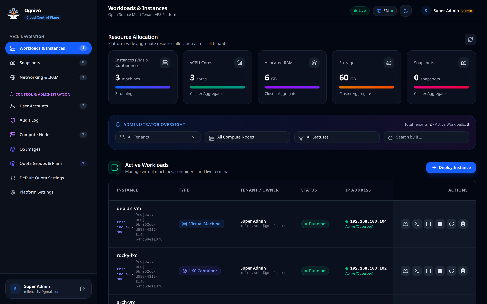

# Quickstart Guide

Detailed step-by-step walkthrough from a fresh `git clone` to a fully initialized and running **Ognivo** environment.

---

## 1. Prerequisites

Ensure the following tools are installed on your host machine:

- **Docker Engine** `24.0+`
- **Docker Compose v2** (`docker compose`, `2.20+`)
- **GNU Make**
- **OpenSSL** and **Bash** (used to generate cryptographic secrets)
- **Free Host Ports:**
  - **Development:** `80` (Nginx HTTP), `3000` (Next.js HMR), `8080` (Reverb WS), `3306` (`127.0.0.1` MySQL)
  - **Production:** `80` (HTTP redirect & health probe), `443` (Nginx HTTPS)

---

## 2. Clone & Initialize Cryptographic Secrets

Clone the repository and generate your environment files:

```bash
git clone <repository-url> ognivo
cd ognivo

# Generate .env.development and .env.production from *.example templates
make secrets
```

### What `make secrets` does:
Runs [`scripts/gen-secrets.sh`](../../scripts/gen-secrets.sh), which creates `.env.development` and `.env.production` (if missing), creates a convenience symlink `backend/.env -> ../.env.development` for host CLI/IDE tooling, and populates cryptographically random secrets:
- **Application & Reverb keys:** `APP_KEY` (AES-256-CBC), `REVERB_APP_KEY`, `REVERB_APP_SECRET`, `NEXT_PUBLIC_REVERB_APP_KEY`
- **MySQL credentials:** `DB_PASSWORD`, `DB_ROOT_PASSWORD`, `DB_MIGRATION_PASSWORD`
- **Audit subsystem keys:** `AUDIT_DB_PASSWORD`, `AUDIT_MAINT_DB_PASSWORD`, `AUDIT_HMAC_KEY` (64-hex-char SHA-256 HMAC key), `AUDIT_PSEUDONYM_SALT`

> [!NOTE]
> - **Idempotent by design:** Running `make secrets` multiple times will **never** overwrite existing valid secrets.
> - **Auto-triggered:** Running `make up-dev`, `make up-prod`, `make build-dev`, or `make build-prod` automatically runs `make secrets` if the corresponding `.env.*` file does not exist yet.
> - **Applying `.env` changes / key rotations:** Whenever you manually edit `.env.development` or `.env.production` or rotate keys, run `make up-dev` or `make up-prod` so Docker Compose recreates the containers with the updated environment variables.

---

## 3. Initial Build & First-Time Startup

> [!IMPORTANT]
> ### Does `make up-dev` / `make up-prod` build Docker images automatically?
> - **Yes, on first run:** If the local Docker images (`ognivo-backend`, `ognivo-frontend`, `ognivo-console-proxy`) do not exist yet, running `make up-dev` or `make up-prod` will **automatically build them** before starting the containers.
> - **When to run `make build-dev` or `make build-prod` explicitly:** Once the images exist locally, Docker Compose reuses them on subsequent `make up-*` runs. Run `make build-dev` or `make build-prod` whenever you pull updates that modify a `Dockerfile`, `composer.json`, `package.json`, or (in Production) frontend `NEXT_PUBLIC_*` environment variables and source code.

Choose either **Option A (Development)** or **Option B (Production)** below. Starting one environment automatically stops the other to prevent host port conflicts.

---

### Option A: Development Environment (First-Time Setup)

Ideal for local evaluation, feature development, and testing with pre-seeded demo data and live hot-reloading.

#### Step 1: Start the Development Stack
```bash
make up-dev
```

#### What happens automatically under the hood on first boot:
1. **Image Build:** Docker Compose builds `ognivo-backend:dev`, `ognivo-frontend:dev`, and `ognivo-console-proxy:dev` (if not already built).
2. **Database & Cache Init:** `ognivo-db-dev` (MySQL 8.4) initializes the `ognivo` database and runs [`docker/mysql-init/01-create-users.sh`](../../docker/mysql-init/01-create-users.sh) to provision the application, migration, and audit DB users.
3. **Backend Dependencies & Migrations:** Once MySQL and Redis report `healthy`, `ognivo-backend-dev` runs [`backend/docker-entrypoint.sh`](../../backend/docker-entrypoint.sh):
   - Installs PHP Composer dependencies into `backend/vendor/` automatically if missing on the host bind mount.
   - Runs `php artisan migrate --force` and applies audit table privileges via `php artisan audit:grants --force`.
   - Runs `php artisan db:seed --force` to populate demo accounts, quota tiers, fake hypervisor nodes, and a default IPv4 subnet pool.
4. **Daemons & Web Server:** `queue-worker`, `scheduler`, `incus-events`, `reverb`, `console-proxy`, `frontend` (Next.js Turbopack), and `webserver` (Nginx) start up.

#### Step 2: Sign In to the Web Panel
Wait ~20–30 seconds on the very first run for MySQL initialization and migrations to finish (check with `make ps`), then open:

- **Web Panel URL:** `http://localhost` *(or `http://localhost:3000`)*
- **Interactive API Docs (OpenAPI):** `http://localhost/docs/api`
- **Health Check:** `http://localhost/up`

| Role | Email | Password | Quota Tier |
| :--- | :--- | :--- | :--- |
| **Administrator** | `admin@ognivo.local` | `password` | **Enterprise Unlimited** (`∞` resources) |
| **Customer** | `customer@ognivo.local` | `password` | **Standard Tier** (`3` VMs, `6` vCPU, `8 GB` RAM) |



> [!CAUTION]
> **Local Machine Only:** The development stack (`make up-dev`) seeds well-known demo credentials and enables debug tooling. Never run `make up-dev` on a public internet-facing server — always use `make up-prod` for remote or production deployments.

👉 *For full details on seeded hypervisors, IP pools, and local ports, see [Development Environment](development.md).*

---

### Option B: Production Environment (First-Time Setup)

Hardened, self-contained deployment with HTTPS on port `443`, strict MySQL privilege separation, and zero internal port exposure.

#### Step 1: Configure Domain (Optional — Defaults to `localhost`)
If deploying on a real domain (e.g., `panel.example.com`), update `.env.production` **before** building:
```ini
APP_URL=https://panel.example.com
REVERB_ALLOWED_ORIGINS=https://panel.example.com
SANCTUM_STATEFUL_DOMAINS=panel.example.com
```

#### Step 2: Build & Start the Production Stack
```bash
make build-prod
make up-prod
```

#### What happens automatically under the hood on first boot:
1. **TLS Bootstrap (`cert-init`):** Checks `./docker/certs/` on the host. If `server.crt` and `server.key` are not present, it automatically generates a self-signed X.509 TLS certificate so Nginx can start immediately over HTTPS.
2. **Production Safety Check:** `ognivo-backend` executes `php artisan app:check-production-config` and refuses to boot if any unsafe default passwords, debug flags, or wildcard origins exist.
3. **Automated Migrations & Strict Audit Grants:** Runs `php artisan migrate --force` and `php artisan audit:grants --force` (enforcing `INSERT`/`SELECT`-only privileges on audit tables). Database seeders are strictly disabled (`RUN_SEEDERS=false`).
4. **HTTPS Ingress:** `ognivo-nginx` starts on ports `80` (redirects to HTTPS) and `443` (TLS 1.2/1.3).

#### Step 3: Create the Initial Administrator Account
Because demo seeders are disabled in production, create your first admin user via Artisan:
```bash
docker exec -it ognivo-backend php artisan admin:create admin@yourdomain.com --name="Super Admin"
```
*(Omit `--password=...` to have a strong 16-character password generated and printed to your terminal, or pass `--password="YourStrongPassword"`.)*

- **Web Panel URL:** `https://localhost` *(or your configured `APP_URL`)*
- **Health Check:** `https://localhost/up`

#### Step 4: Replace the Self-Signed Nginx TLS Certificate (Optional)
By default, browsers will show a self-signed certificate warning on `https://localhost`. To install a real certificate (e.g., Let's Encrypt or Custom CA), copy your certificate and private key into `./docker/certs/` and reload Nginx without downtime:

```bash
cp /path/to/fullchain.pem docker/certs/server.crt
cp /path/to/privkey.pem docker/certs/server.key
chmod 600 docker/certs/server.key
chmod 644 docker/certs/server.crt

# Reload Nginx configuration and certificates with zero downtime
docker exec ognivo-nginx nginx -s reload
```

👉 *For full production details, Let's Encrypt volume mounts, and Day-2 operations, see [Production Deployment](../operations/production.md).*

---

## 4. Day-to-Day Lifecycle Commands

| Action | Development | Production |
| :--- | :--- | :--- |
| **Start Stack** *(auto-builds if missing)* | `make up-dev` | `make up-prod` |
| **Rebuild Images** *(after dependency/code changes)* | `make build-dev` | `make build-prod` |
| **Check Container Status & Health** | `make ps` | `make ps` |
| **Follow Live Container Logs** | `make logs-dev` | `make logs-prod` |
| **Stop Stack** | `make down-dev` | `make down-prod` |
| **Wipe DB Volume & Re-seed Fresh Dev** | `make reset-dev` | *N/A (protected)* |

---

## 5. Where to Go Next

- **Development Topology & Seed Data:** [development.md](development.md)
- **Production Deployment & TLS Setup:** [../operations/production.md](../operations/production.md)
- **All CLI & Makefile Commands:** [../operations/commands.md](../operations/commands.md)
- **Environment Variables & Key Rotation:** [../operations/configuration.md](../operations/configuration.md)
- **Onboarding Incus/LXD Nodes:** [../features/host-onboarding.md](../features/host-onboarding.md)
- **Troubleshooting Common Issues:** [../operations/troubleshooting.md](../operations/troubleshooting.md)
